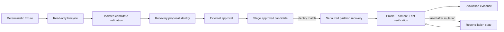

> [!NOTE]
> 기존 read-only lifecycle, HMDA partition loader, dbt stage runner와 recovery API를 유지하면서 stable content identity, transaction 내부 compare-and-replace, run-scoped dbt artifact와 mutation-aware recovery state를 추가한다. 별도 orchestration이나 새 top-level package 없이 reliability evaluation API가 deterministic clean/`volume_drop` acceptance를 조합한다.

## Context

- **Current State:** Approval은 incident와 action만 식별하고 recovery는 partition overwrite 이후 row count만 비교한다. dbt runner는 shared artifact를 실행 전에 삭제하며 recovery result는 mutation 전후 failure를 구분하지 않는다.
- **Constraints:** Local DuckDB와 filesystem 기반 single-writer 범위, read-only incident lifecycle, approval 이후 별도 recovery API, existing domain ownership을 유지한다.
- **Dependencies:** 완료됐지만 active인 runtime/ingestion Change 네 개와 delta overlap이 있으므로 Apply 전에 archive/sync하거나 현재 Change가 해당 delta를 완전하게 보존하는지 확인한다. 최신 `main`에서 reliability, HMDA ingestion과 dbt runner baseline을 재실행한다.
- **Implementation Review Input:** Current-head review에서 dbt target resolution, unsafe recursive cleanup, approved candidate/source binding, artifact publication provenance, post-mutation failure evidence, evaluation isolation과 falsifiability가 부족한 것이 확인됐다. 이 finding은 기존 MVP 범위 안의 safety contract 누락 또는 구현 불일치로 처리한다.

## Goals / Non-Goals

| Goals | Non-Goals |
| --- | --- |
| Exact recovery proposal과 approval binding | Approval UI, cryptographic signature와 RBAC |
| Duplicate-aware stable partition identity | 전체 database 또는 dbt model content hashing |
| Approved candidate와 target-state를 mutation 전에 검증 | Distributed lock과 multi-process writer coordination |
| Candidate/target dbt run isolation과 last-known-good promotion | Artifact registry와 장기 retention service |
| Post-mutation failure와 reconciliation | Cross-system rollback |
| Deterministic clean/`volume_drop` acceptance | 다른 incident type과 Dagster control-plane |

## Architecture

Read-only lifecycle은 current partition identity와 dbt projection identity를 결과에 추가할 뿐 recovery를 실행하지 않는다. Candidate source는 별도 DuckDB database와 run-scoped dbt target directory에서 검증되고, 해당 identity 묶음으로 recovery proposal을 만든다. Approval은 proposal identity와 target mutation action을 포함한다.

Recovery executor는 실제 recovery source를 staging한 뒤 그 content identity가 approved expected-after identity와 같은지 먼저 확인한다. 그 다음 partition loader의 compare-and-replace 경계에서 approved-before identity를 재확인하고, 같은 serialized transaction에서 target을 교체한다. 이후 profile, content identity와 target dbt verification을 수행하며 성공한 exact dbt run만 current projection으로 promotion한다.

### Components

| Component | Responsibility | Change |
| --- | --- | --- |
| `hmda_data.ingestion` | Partition scope와 atomic replacement | `PartitionContentIdentity`, staging candidate identity와 transaction 내부 expected-state 비교를 제공한다. |
| `data_operations.runner` | Independent dbt build stage | Trusted run root 아래 unique run workspace, failure evidence, run-bound promotion과 projection consistency를 제공한다. |
| `data_operations.incident_lifecycle` | Read-only detection/impact/draft composition | Target content와 exact dbt projection identity를 recovery proposal input으로 반환한다. |
| `reliability.contracts` | Approval과 immutable identity contract | Candidate, evidence, before/after target과 action을 하나의 immutable recovery proposal/approval binding으로 묶는다. |
| `reliability.recovery` | Approved mutation과 verification | Gate, staging candidate check, compare-and-replace, mutation state, content oracle와 reconciliation을 조합한다. |
| `reliability.evaluation` | Synthetic case aggregation | Disposable workspace에서 clean/`volume_drop` runner와 실제 failure evidence를 기존 report와 분리된 API로 제공한다. |

### Boundaries

| Boundary | Owns | Does Not Own |
| --- | --- | --- |
| Ingestion | Canonical partition scope, row multiset identity, atomic compare-and-replace | Approval과 recovery policy |
| Data Operations | dbt process, trusted run workspace, run artifact, promotion과 process failure | Candidate correctness와 recovery state machine |
| Reliability lifecycle | Read-only current observation과 proposal inputs | Candidate mutation, approval과 target recovery |
| Reliability recovery | Approval policy, candidate/source binding, state reconciliation과 verification ordering | Raw SQL replacement internals과 dbt process internals |
| Reliability evaluation | Disposable deterministic case composition과 acceptance evidence | Production target mutation, scheduling과 report retention |

## Data Flow

| Step | From | To | Data / Contract |
| ---: | --- | --- | --- |
| 1 | Fixture source | Baseline workspace | Stable fixture identity, clean partition content identity와 baseline profile |
| 2 | Defect source | Lifecycle | Controlled `sample_fraction`, current profile, incident와 recovery proposal inputs |
| 3 | Candidate workspace | Approval request | Candidate content identity, candidate dbt projection, validation evidence와 approved before/after identity |
| 4 | Approval | Recovery executor | Immutable exact proposal identity와 target mutation actions |
| 5 | Recovery source | Staging candidate | Actual source content identity와 expected-after identity pre-mutation check |
| 6 | Recovery executor | Partition loader | Scope, staged candidate와 expected current identity |
| 7 | Target partition | Verification | Actual content identity, profile snapshot, exact target dbt run evidence와 mutation state |
| 8 | Verification | Evaluation | Detection, approval, recovery, reconciliation과 artifact projection evidence |

## Decisions

### D1. Partition identity는 deterministic row multiset digest다

- **Decision** - Partition scope의 schema-ordered logical columns를 DuckDB에서 canonical row value로 투영하고 row별 digest를 정렬해 하나의 versioned SHA-256 digest로 만든다. `ingested_at`처럼 실행마다 달라지는 provenance만 제외하고 `source_file` 계열을 포함하며 duplicate digest를 제거하지 않는다.
- **Rationale** - Row order에 독립적이고 duplicate multiplicity와 모든 logical value drift를 보존한다. Python으로 전체 row를 materialize하지 않고 DuckDB aggregation/ordered scan으로 계산할 수 있다.
- **Trade-off** - Full partition scan 비용이 들지만 MVP의 local fixture와 recovery correctness에 적합하다.
- **Alternatives** - Row count는 semantic drift를 놓치고, table checksum extension은 portability와 dependency를 늘리므로 선택하지 않는다.

### D2. Candidate와 target freshness를 serialized replacement 전에 함께 검증한다

- **Decision** - Recovery source를 staging relation으로 먼저 고정하고 stable content identity를 계산해 proposal의 expected-after identity와 비교한다. Candidate mismatch는 zero-mutation으로 종료한다. Candidate가 일치할 때만 replacement transaction에서 actual current identity를 approved-before identity와 비교하고, 같으면 staged rows로 delete/insert/commit한다.
- **Rationale** - Approval 이후 source path가 바뀌거나 잘못 전달되어도 승인되지 않은 content가 target에 commit되는 것을 막고, target check와 mutation 사이 race도 차단한다.
- **Trade-off** - Staging과 두 identity 계산 비용이 추가되지만 MVP의 approval-bound mutation을 직접 보장한다.

### D3. Approval은 immutable versioned recovery proposal binding이다

- **Decision** - Immutable `RecoveryProposal` contract에 incident, partition scope, candidate content identity, candidate validation evidence, approved before/after content identity, dbt projection identity와 target actions를 둔다. `Approval`은 해당 proposal을 포함하고 requested actions도 immutable collection으로 보존한다. Executor는 request와 exact equality를 검증한다.
- **Rationale** - 흩어진 optional digest field나 mutable action list보다 하나의 typed contract가 승인 대상과 실행 대상을 명확히 한다.
- **Trade-off** - Existing approval fixture/caller migration이 필요하지만 silent fallback은 safety contract를 약화하므로 제공하지 않는다.

### D4. dbt run은 trusted workspace에서 생성하고 exact validated run만 promotion한다

- **Decision** - Runner는 trusted run root 아래에 run identity로 구분된 unique child directory를 만들고, dbt CLI와 artifact inspection에 같은 canonical path를 사용한다. Project/profile/current projection/run root/outside-root path는 destructive cleanup 대상으로 거부한다. `DbtBuildResult`는 run/request provenance와 projection identity를 보존하고 promotion 시 source bytes를 다시 검증한다. Current publication은 manifest/run-results pair를 하나의 projection으로 취급해 mixed pair를 consumer에게 노출하지 않으며, install commit 이후 backup cleanup failure는 installed projection을 되돌리는 이유가 아니다.
- **Rationale** - Default path resolution 오류와 arbitrary `rmtree` surface를 제거하고 candidate/failed run evidence, validated-run provenance와 prior last-known-good를 동시에 보존한다.
- **Trade-off** - Run directory retention과 obsolete backup cleanup 책임이 분리되며 작은 provenance metadata가 추가된다.

### D5. Recovery result는 closed state vocabulary와 mutation-aware evidence를 사용한다

- **Decision** - Result에 typed `mutation_state`와 `reconciliation_action`, before/expected/actual identity, validation 항목과 dbt run evidence를 포함한다. Current가 expected after와 같으면 overwrite를 건너뛰고 verification만 재개하며 diverged state는 새 approval을 요구한다. Partition commit 이후 profile/content/dbt verification failure도 structured result/failure에 mutation state와 identities를 남긴다.
- **Rationale** - Exception이나 자유 문자열만으로는 partition commit 이후 failure와 pre-mutation failure를 구분하거나 안전한 retry를 결정할 수 없다.
- **Trade-off** - Result contract가 커지지만 recovery policy를 caller 추론에 맡기지 않고 typo가 safety evidence로 통과하는 것을 막는다.

### D6. Vertical-slice evaluation은 disposable workspace와 관찰된 failure를 사용한다

- **Decision** - Deterministic fixture 생성, baseline/current load, lifecycle, candidate validation, external approval input, recovery와 evaluation case 변환을 `reliability.evaluation`의 별도 API로 둔다. Synthetic defect target은 caller의 일반 database가 아니라 disposable workspace에 둔다. Failure stage, mutation 여부와 artifact preservation은 실제 runner/recovery 결과에서 도출하고 caller가 제공한 임의 문자열은 acceptance oracle로 사용하지 않는다. Multi-year source는 requested `source_year`로 scope하고 deterministic sampling은 total ordering을 가진다.
- **Rationale** - End-to-end acceptance가 실제 target을 오염시키거나 callback 문자열만으로 false-green되는 것을 막으면서 read-only lifecycle과 external approval boundary를 유지한다.
- **Trade-off** - Real local dbt integration이 일부 acceptance test 비용을 높이지만 핵심 MVP safety proof에 한정한다.

## Testability

| Boundary / Behavior | Test Strategy | Evidence |
| --- | --- | --- |
| Content identity invariants | DuckDB component + property-style parameter cases | Order/volatile metadata는 같고 value/duplicate drift는 다른 digest |
| Approved candidate binding | DuckDB/recovery component | Different source content는 target mutation 전에 실패하고 target identity가 유지됨 |
| Serialized replacement | DuckDB component | Expected identity 일치 시 교체, stale identity 시 zero mutation |
| Approval binding | Reliability unit/component | Missing/mismatched proposal과 post-construction action mutation이 source access 전 실패 |
| dbt workspace safety | Real local dbt integration + component | Default path가 실제 artifact location과 일치하고 dangerous cleanup path는 zero modification |
| dbt promotion provenance | Data Operations component with failure injection | Cross-run/artifact mutation/mid-publish/cleanup failure에서 current projection consistency 유지 |
| Mutation/reconciliation state | Recovery component with fault injection | Profile/content/dbt post-mutation failure와 resume/diverged result 구분 |
| Evaluation isolation | Local integration | Caller target unchanged, requested source-year provenance와 deterministic sample identity 유지 |
| Clean/volume-drop slice | Runner-backed local integration | Detection, impact, exact approval, content recovery, real dbt verification과 replay evidence |

- **TDD Boundary:** Review remediation은 가장 좁은 regression RED부터 추가한다. Default dbt path, dangerous cleanup, candidate-source mismatch, promotion provenance, post-mutation failure, evaluation target isolation을 각각 독립 oracle로 고정한 뒤 GREEN 구현을 연결한다.
- **Failure Signals:** Unexpected target fingerprint change, current artifact mixed projection, overwrite 반복, unknown mutation state 수용, missing failed-run evidence, caller target mutation 또는 unstable repeated evidence다.

## Risks

| Risk | Impact | Mitigation |
| --- | --- | --- |
| Canonical projection이 type/null을 모호하게 직렬화 | 서로 다른 content가 같은 identity를 가질 수 있다. | Type-aware encoding과 null marker를 사용하고 collision-oriented component cases를 둔다. |
| dbt run path가 project-relative로 이중 resolve됨 | 실제 artifact와 runner inspection path가 달라진다. | Canonical run path를 한 번 resolve해 CLI와 inspection에 동일하게 사용하고 real dbt test로 고정한다. |
| Artifact publication이 부분 관찰됨 | Manifest와 run results가 다른 run을 가리킨다. | Exact run provenance와 projection-consistent publication/read contract를 두고 failure/concurrency test를 둔다. |
| Recovery API가 너무 많은 orchestration을 소유 | Read-only/recovery 경계가 흐려진다. | Candidate validation과 evaluation composition을 별도 API에 두고 executor는 approved target mutation만 담당한다. |
| Evaluation이 caller target을 synthetic defect로 변경 | Acceptance helper가 실제 local data를 손상한다. | Disposable workspace를 기본 경계로 강제한다. |
| Existing active Change archive 순서가 delta를 덮음 | Canonical Spec 또는 source contract가 회귀한다. | Apply 전에 active Change를 archive/sync하거나 이 delta의 complete Requirement와 source baseline을 다시 대조한다. |
| Full partition digest 비용 | 큰 partition recovery가 느려진다. | MVP는 local fixture/partition scope로 제한하고 성능 evidence가 필요할 때 후속 최적화한다. |

## Migration

| Phase | Change | Verification |
| ---: | --- | --- |
| 1 | 관련 완료 Change를 archive/sync하거나 delta 비중첩을 확인한다. | OpenSpec strict validation과 canonical Requirement 대조 |
| 2 | Approval/recovery caller를 immutable versioned proposal contract로 전환한다. | Contract tests와 source-access-before-gate tests |
| 3 | Partition candidate binding과 trusted dbt run workspace를 도입한다. | HMDA ingestion, Data Operations focused suites와 real dbt path test |
| 4 | Recovery state와 disposable volume-drop evaluation을 연결한다. | Reliability suite와 runner-backed deterministic integration acceptance |

- **Compatibility:** 기존 read-only lifecycle, ingestion default와 independent dbt stage API는 유지한다. Approved recovery caller는 안전 계약상 새 proposal binding을 제공해야 한다.
- **Rollback:** Target mutation 전 실패는 기존 state를 유지한다. Post-mutation failure는 prior artifact와 run evidence를 보존하고 expected-after identity에서 verification만 재개한다.
