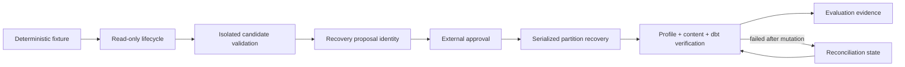

> [!NOTE]
> 기존 read-only lifecycle, HMDA partition loader, dbt stage runner와 recovery API를 유지하면서 stable content identity, transaction 내부 compare-and-replace, run-scoped dbt artifact와 mutation-aware recovery state를 추가한다. 별도 orchestration이나 새 top-level package 없이 reliability evaluation API가 deterministic clean/`volume_drop` acceptance를 조합한다.

## Context

- **Current State:** Approval은 incident와 action만 식별하고 recovery는 partition overwrite 이후 row count만 비교한다. dbt runner는 shared artifact를 실행 전에 삭제하며 recovery result는 mutation 전후 failure를 구분하지 않는다.
- **Constraints:** Local DuckDB와 filesystem 기반 single-writer 범위, read-only incident lifecycle, approval 이후 별도 recovery API, existing domain ownership을 유지한다.
- **Dependencies:** 완료됐지만 active인 runtime/ingestion Change 네 개와 delta overlap이 있으므로 Apply 전에 archive/sync하거나 현재 Change가 해당 delta를 완전하게 보존하는지 확인한다. 최신 `main`에서 reliability, HMDA ingestion과 dbt runner baseline을 재실행한다.

## Goals / Non-Goals

| Goals | Non-Goals |
| --- | --- |
| Exact recovery proposal과 approval binding | Approval UI, cryptographic signature와 RBAC |
| Duplicate-aware stable partition identity | 전체 database 또는 dbt model content hashing |
| Target-state 확인과 mutation의 single transaction | Distributed lock과 multi-process writer coordination |
| Candidate/target dbt run isolation과 last-known-good promotion | Artifact registry와 장기 retention service |
| Post-mutation failure와 reconciliation | Cross-system rollback |
| Deterministic clean/`volume_drop` acceptance | 다른 incident type과 Dagster control-plane |

## Architecture

Read-only lifecycle은 current partition identity와 dbt projection identity를 결과에 추가할 뿐 recovery를 실행하지 않는다. Candidate source는 별도 DuckDB database와 run-scoped dbt target directory에서 검증되고, 해당 identity 묶음으로 recovery proposal을 만든다. Approval은 proposal identity와 target mutation action을 포함한다. Recovery executor는 partition loader의 compare-and-replace API를 호출해 같은 DuckDB transaction 안에서 approved before identity를 확인하고 partition을 교체한다. 이후 profile, content identity와 target dbt verification을 수행하며, 성공한 dbt run만 current artifact projection으로 promotion한다.

### Components

| Component | Responsibility | Change |
| --- | --- | --- |
| `hmda_data.ingestion` | Partition scope와 atomic replacement | `PartitionContentIdentity` 계산과 transaction 내부 expected-state 비교를 추가한다. |
| `data_operations.runner` | Independent dbt build stage | Run-scoped target path, failure evidence와 explicit current artifact promotion을 추가한다. |
| `data_operations.incident_lifecycle` | Read-only detection/impact/draft composition | Target content와 dbt projection identity를 recovery proposal input으로 반환한다. |
| `reliability.contracts` | Approval과 immutable identity contract | Candidate, evidence, before/after target과 action을 하나의 recovery proposal identity로 묶는다. |
| `reliability.recovery` | Approved mutation과 verification | Gate, compare-and-replace, mutation state, content oracle와 reconciliation을 조합한다. |
| `reliability.evaluation` | Synthetic case aggregation | Clean/`volume_drop` runner와 safety case evidence를 기존 report와 분리된 API로 제공한다. |

### Boundaries

| Boundary | Owns | Does Not Own |
| --- | --- | --- |
| Ingestion | Canonical partition scope, row multiset identity, atomic compare-and-replace | Approval과 recovery policy |
| Data Operations | dbt process, run artifact, promotion과 process failure | Candidate correctness와 recovery state machine |
| Reliability lifecycle | Read-only current observation과 proposal inputs | Candidate mutation, approval과 target recovery |
| Reliability recovery | Approval policy, state reconciliation과 verification ordering | Raw SQL replacement internals과 dbt process internals |
| Reliability evaluation | Deterministic case composition과 acceptance evidence | Production scheduling과 report retention |

## Data Flow

| Step | From | To | Data / Contract |
| ---: | --- | --- | --- |
| 1 | Fixture source | Baseline target | Stable fixture identity, clean partition content identity와 baseline profile |
| 2 | Defect source | Lifecycle | Controlled `sample_fraction`, current profile, incident와 recovery proposal inputs |
| 3 | Candidate workspace | Approval request | Candidate content identity, candidate dbt projection, validation evidence와 approved before/after identity |
| 4 | Approval | Recovery executor | Exact proposal identity와 target mutation actions |
| 5 | Recovery executor | Partition loader | Scope, source paths와 expected current identity |
| 6 | Target partition | Verification | Actual content identity, profile snapshot, target dbt run evidence와 mutation state |
| 7 | Verification | Evaluation | Detection, approval, recovery, reconciliation과 artifact projection evidence |

## Decisions

### D1. Partition identity는 deterministic row multiset digest다

- **Decision** - Partition scope의 schema-ordered logical columns를 DuckDB에서 canonical row value로 투영하고 row별 digest를 정렬해 하나의 versioned SHA-256 digest로 만든다. `ingested_at`처럼 실행마다 달라지는 provenance만 제외하고 `source_file` 계열을 포함하며 duplicate digest를 제거하지 않는다.
- **Rationale** - Row order에 독립적이고 duplicate multiplicity와 모든 logical value drift를 보존한다. Python으로 전체 row를 materialize하지 않고 DuckDB aggregation/ordered scan으로 계산할 수 있다.
- **Trade-off** - Full partition scan 비용이 들지만 MVP의 local fixture와 recovery correctness에 적합하다.
- **Alternatives** - Row count는 semantic drift를 놓치고, table checksum extension은 portability와 dependency를 늘리므로 선택하지 않는다.

### D2. Freshness는 partition transaction 내부 compare-and-replace로 보장한다

- **Decision** - Existing staging validation 후 `BEGIN TRANSACTION` 안에서 actual current identity를 계산해 expected identity와 비교하고, 같을 때만 delete/insert/commit한다. 불일치는 typed stale-state failure로 rollback한다.
- **Rationale** - 별도 lock service 없이 현재 DuckDB single-writer boundary에서 check와 mutation 사이 race를 막는다.
- **Trade-off** - 외부 process가 같은 database를 비표준 경로로 쓰는 multi-writer coordination은 제공하지 않는다.

### D3. Approval은 versioned recovery proposal identity를 직접 포함한다

- **Decision** - Immutable `RecoveryProposal` contract에 incident, partition scope, candidate content identity, candidate validation evidence, approved before/after content identity, dbt projection identity와 target actions를 둔다. `Approval`은 해당 proposal을 포함하고 executor는 request와 exact equality를 검증한다.
- **Rationale** - 흩어진 optional digest field보다 하나의 typed contract가 승인 대상과 실행 대상을 명확히 한다.
- **Trade-off** - Existing approval fixture/caller migration이 필요하지만 silent fallback은 safety contract를 약화하므로 제공하지 않는다.

### D4. dbt artifact는 run directory에서 생성하고 성공 시 promotion한다

- **Decision** - dbt command에 unique caller-provided run target path를 사용한다. Runner는 run result와 artifact path를 보존하고 current projection을 직접 삭제하지 않는다. Target run의 caller validation 성공 후에만 manifest/run_results pair를 temporary copy 후 replace로 promotion한다. Candidate는 promotion하지 않는다.
- **Rationale** - Candidate/failed run과 prior last-known-good를 동시에 보존하며 stale artifact success를 차단한다.
- **Trade-off** - Run directory cleanup과 retention은 caller가 소유하며 MVP는 자동 기간 삭제를 추가하지 않는다.

### D5. Recovery result는 mutation phase와 reconciliation action을 명시한다

- **Decision** - Result에 `mutation_state`와 `reconciliation_action`, before/expected/actual identity, validation 항목과 dbt run evidence를 포함한다. Current가 expected after와 같으면 overwrite를 건너뛰고 verification만 재개하며 diverged state는 새 approval을 요구한다.
- **Rationale** - Exception만으로는 partition commit 이후 failure와 pre-mutation failure를 구분하거나 안전한 retry를 결정할 수 없다.
- **Trade-off** - Result contract가 커지지만 recovery policy를 caller 추론에 맡기지 않는다.

### D6. Vertical-slice runner는 evaluation API가 조합한다

- **Decision** - Deterministic fixture 생성, baseline/current load, lifecycle, candidate validation, external approval 입력, recovery와 evaluation case 변환을 `reliability.evaluation`의 별도 API로 둔다. Approval 생성은 caller callback/input으로 유지한다.
- **Rationale** - End-to-end acceptance를 제공하면서 read-only lifecycle과 external approval boundary를 유지한다.
- **Trade-off** - Dagster scheduling과 CLI는 제공하지 않으며 직접 Python API로 검증한다.

## Testability

| Boundary / Behavior | Test Strategy | Evidence |
| --- | --- | --- |
| Content identity invariants | DuckDB component + property-style parameter cases | Order/volatile metadata는 같고 value/duplicate drift는 다른 digest |
| Serialized replacement | DuckDB component | Expected identity 일치 시 교체, stale identity 시 zero mutation |
| Approval binding | Reliability unit/component | Missing/mismatched proposal이 source access 전 실패 |
| dbt isolation/promotion | Data Operations component with subprocess boundary stub | Candidate/failed run은 current 보존, validated target만 pair promotion |
| Mutation/reconciliation state | Recovery component | Pre/post mutation failure와 resume/diverged result 구분 |
| Clean/volume-drop slice | Local integration | Detection, impact, exact approval, content recovery, dbt verification과 replay evidence |

- **TDD Boundary:** Content identity와 compare-and-replace를 가장 먼저 RED로 고정한 뒤 approval, dbt artifact와 recovery state를 순서대로 연결한다.
- **Failure Signals:** Unexpected target fingerprint change, current artifact pair change, overwrite call 반복, incorrect mutation state, missing failed-run evidence 또는 unstable repeated evidence다.

## Risks

| Risk | Impact | Mitigation |
| --- | --- | --- |
| Canonical projection이 type/null을 모호하게 직렬화 | 서로 다른 content가 같은 identity를 가질 수 있다. | Type-aware encoding과 null marker를 사용하고 collision-oriented component cases를 둔다. |
| Artifact pair가 부분 promotion됨 | Manifest와 run results가 다른 run을 가리킨다. | 두 temporary file을 모두 준비한 뒤 pair identity metadata와 함께 replace하고 failure injection test를 둔다. |
| Recovery API가 너무 많은 orchestration을 소유 | Read-only/recovery 경계가 흐려진다. | Candidate validation과 evaluation composition을 별도 API에 두고 executor는 approved target mutation만 담당한다. |
| Existing active Change archive 순서가 delta를 덮음 | Canonical Spec 또는 source contract가 회귀한다. | Apply 전에 active Change를 archive/sync하거나 이 delta의 complete Requirement와 source baseline을 다시 대조한다. |
| Full partition digest 비용 | 큰 partition recovery가 느려진다. | MVP는 local fixture/partition scope로 제한하고 성능 evidence가 필요할 때 후속 최적화한다. |

## Migration

| Phase | Change | Verification |
| ---: | --- | --- |
| 1 | 관련 완료 Change를 archive/sync하거나 delta 비중첩을 확인한다. | OpenSpec strict validation과 canonical Requirement 대조 |
| 2 | Approval/recovery caller를 versioned proposal contract로 전환한다. | Contract tests와 source-access-before-gate tests |
| 3 | Partition identity와 dbt run workspace를 도입한다. | HMDA ingestion 및 Data Operations focused suites |
| 4 | Recovery state와 volume-drop evaluation을 연결한다. | Reliability suite와 deterministic integration acceptance |

- **Compatibility:** 기존 read-only lifecycle, ingestion default와 independent dbt stage API는 유지한다. Approved recovery caller는 안전 계약상 새 proposal binding을 제공해야 한다.
- **Rollback:** Target mutation 전 실패는 기존 state를 유지한다. Post-mutation failure는 prior artifact와 run evidence를 보존하고 expected-after identity에서 verification만 재개한다.
