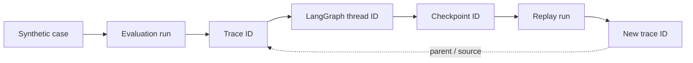

## Summary

> [!NOTE]
> Project Pivot은 observability backend보다 **instrumentation contract를 먼저** 가져야 한다. Foundation에는 backend를 추가하지 않고, synthetic evaluation runner와 실제 LangGraph remediation path가 생긴 뒤 node·model·tool·approval 단위의 vendor-neutral span을 추가한다. 초기 선택은 raw OpenTelemetry 또는 local MLflow가 작고, prompt/version/evaluation UX가 핵심이 되는 시점에는 Langfuse가 강하다. Grafana·Tempo·Loki stack은 현재 local MVP에 과하다.

## Question

- **Primary:** Project Pivot MVP에서 agent 판단, tool call, 비용·지연, 실패와 replay를 어떤 범위로 관측해야 하는가?
- **Scope:** LangGraph remediation draft, synthetic evaluation run, human approval handoff와 local development trace를 포함한다. production infrastructure monitoring, cluster metrics와 장기 SLO는 제외한다.
- **Stop Condition:** 최소 trace schema, checkpoint 연계, content policy, backend 선택 기준과 도입 시점을 정의할 수 있으면 종료한다.

## Findings

### F1. backend보다 안정적인 trace shape가 먼저다

OpenTelemetry는 manual span, nested span, attribute, event와 exception recording을 제공한다. backend와 독립적인 instrumentation API를 사용하면 console·file·OTLP exporter를 교체할 수 있다. Project Pivot에는 이미 OpenTelemetry API와 SDK가 dev dependency로 존재하므로 별도 platform 없이 contract를 검증할 수 있다.

- **Evidence** - OpenTelemetry Python instrumentation 공식 문서, `pyproject.toml`
- **Implication** - 첫 change는 vendor SDK 도입이 아니라 application-owned tracing adapter와 span naming convention이어야 한다.

### F2. 최소 trace는 lifecycle과 evaluation을 연결해야 한다

| Level | Span / Attribute |
| --- | --- |
| Run | `run.id`, `evaluation.case.id`, environment, Git SHA, source identity |
| Workflow | graph name/version, thread ID, checkpoint ID, final status |
| Node | node name/version, attempt, duration, decision or route |
| Model | provider, model, prompt version, input/output token, latency, cost |
| Tool | tool name/version, argument/result hash, status, error type |
| Approval | request ID, decision state, actor class, timestamp; sensitive identity 제외 가능 |
| Evaluation | evaluator name/version, score, expected/actual status |

Full prompt, source row와 tool argument는 default attribute로 저장하지 않는다. content capture는 opt-in으로 하고 hash, size, schema와 redacted preview를 기본으로 둔다.

- **Evidence** - OpenTelemetry GenAI convention의 model·tool·usage·evaluation concepts, Langfuse trace best practices
- **Implication** - 개인정보와 high-cardinality payload를 trace backend에 무제한 복제하지 않으면서 비교·debugging에 필요한 identity를 유지할 수 있다.

### F3. LangGraph checkpoint와 trace ID를 양방향으로 연결해야 한다

LangGraph persistence는 graph state를 checkpoint로 저장하며 human-in-the-loop, fault tolerance와 prior checkpoint replay를 지원한다. Replay 시 checkpoint 이후 node와 외부 call이 다시 실행될 수 있으므로 original execution과 replay를 구분해야 한다.

필수 관계는 다음과 같다.

- **Evidence** - LangGraph persistence와 time-travel 공식 문서
- **Implication** - checkpoint ID만 저장하거나 trace만 저장해서는 어떤 state에서 재실행됐는지 입증할 수 없다. replay는 새 trace를 생성하고 source trace/checkpoint를 link로 가진다.

### F4. GenAI semantic convention은 활용하되 project schema를 versioning해야 한다

OpenTelemetry의 GenAI convention은 model operation, token usage, tool call과 evaluation event를 표준화하지만 2026년 현재 별도 repository에서 계속 발전하고 있으며 최근 release에도 breaking change가 있다.

- **Evidence** - OpenTelemetry GenAI Semantic Conventions repository와 release history
- **Implication** - external convention을 그대로 domain contract로 삼지 않는다. Project Pivot의 stable attribute를 adapter가 current GenAI convention으로 변환하고 emitted schema version을 trace에 기록한다.

### F5. backend는 단계별 비용 구조가 다르다

| Option | Strengths | Costs / Limits | Fit |
| --- | --- | --- | --- |
| OpenTelemetry + console/file | dependency와 operation이 최소, vendor-neutral | 검색·비교 UI 없음 | instrumentation contract 개발 |
| MLflow local server | OTel ingest, trace UI와 evaluation, local server 시작이 단순 | prompt management specialization은 약함 | strict local MVP와 evaluation 결과 확인 |
| Langfuse managed | trace, prompt version, dataset, experiment와 score UX가 통합됨 | 외부 service와 data policy 결정 필요 | prompt/model iteration이 본격화된 MVP |
| Langfuse self-hosted v3 | control과 integrated UX | PostgreSQL 외 ClickHouse, Redis/Valkey, blob storage 등 운영 surface 증가 | 현재 local MVP에는 부적합 |
| Grafana + Tempo + Loki | 범용 infrastructure observability | agent eval·prompt UX를 별도 구축해야 함 | production platform 단계 |

MLflow server는 OTLP endpoint와 OpenTelemetry-compatible tracing을 제공한다. Langfuse는 stable trace naming을 evaluator, dashboard와 experiment의 기반으로 사용하며 deterministic code evaluator도 제공하지만 self-hosted v3는 ClickHouse 등 여러 component가 필요하다.

- **Evidence** - MLflow OTel integration, Langfuse tracing/evaluation/self-hosting 공식 문서
- **Implication** - backend 선택은 기능 수가 아니라 현재 필요한 UX와 운영 예산으로 결정해야 한다.

## Options

| Option | Strengths | Weaknesses |
| --- | --- | --- |
| Foundation에서 Langfuse 즉시 도입 | 빠른 UI와 prompt workflow | 아직 agent/eval workload가 작고 Foundation 범위를 확장한다 |
| OTel contract → local MLflow → 필요 시 Langfuse | 작게 시작하며 data portability를 유지한다 | adapter와 migration discipline이 필요하다 |
| Grafana stack 선행 | 범용 monitoring 기반 | local MVP의 핵심인 evaluation·prompt iteration과 거리가 있다 |

## Conclusion

- **Answer** - MVP observability의 최소 단위는 evaluation case부터 LangGraph checkpoint, model/tool execution과 evaluator score까지 연결되는 versioned trace다.
- **Recommendation** - Foundation 종료 후 synthetic evaluation runner에 no-op/console 가능한 OTel-compatible adapter를 먼저 추가한다. 실제 model remediation이 활성화되면 local MLflow로 trace UX를 검증하고, prompt/version/dataset experiment가 반복되는 시점에 Langfuse managed 또는 low-scale deployment를 결정한다. Grafana·Tempo·Loki는 도입하지 않는다.
- **Next Step** - `llmops-trace-contract` OpenSpec change에서 span tree, stable attribute, content redaction, replay link와 exporter interface만 정의한다. backend dependency는 별도 change로 둔다.

## Validation Candidates

1. exporter가 없어도 remediation과 evaluation behavior가 동일한지 확인한다.
2. 한 synthetic case에서 run→node→model/tool→evaluation span hierarchy가 완전한지 확인한다.
3. failure가 exception type, failed node와 checkpoint를 통해 재현 가능한지 확인한다.
4. replay가 새 trace를 만들고 original trace/checkpoint를 link하는지 확인한다.
5. prompt/source payload가 default trace attribute에 평문으로 포함되지 않는지 확인한다.
6. console exporter와 OTLP backend 교체 시 domain attribute가 동일한지 확인한다.

## Evidence

| Evidence | Supports | Location |
| --- | --- | --- |
| Python manual instrumentation | F1, F2 | https://opentelemetry.io/docs/languages/python/instrumentation/ |
| GenAI semantic conventions | F2, F4 | https://github.com/open-telemetry/semantic-conventions-genai |
| LangGraph persistence | F3 | https://docs.langchain.com/oss/python/langgraph/persistence |
| LangGraph time travel | F3 | https://docs.langchain.com/oss/python/langgraph/use-time-travel |
| Langfuse trace structure | F2, F5 | https://langfuse.com/docs/observability/best-practices |
| Langfuse code evaluators | F5 | https://langfuse.com/docs/evaluation/evaluation-methods/code-evaluators |
| Langfuse ClickHouse requirement | F5 | https://langfuse.com/self-hosting/deployment/infrastructure/clickhouse |
| MLflow OTel integration | F5 | https://mlflow.org/docs/latest/genai/tracing/opentelemetry/ |
| Current dependencies | F1 | `pyproject.toml` |
| Architecture scope | F5 | `docs/ARCHITECTURE.md` |
