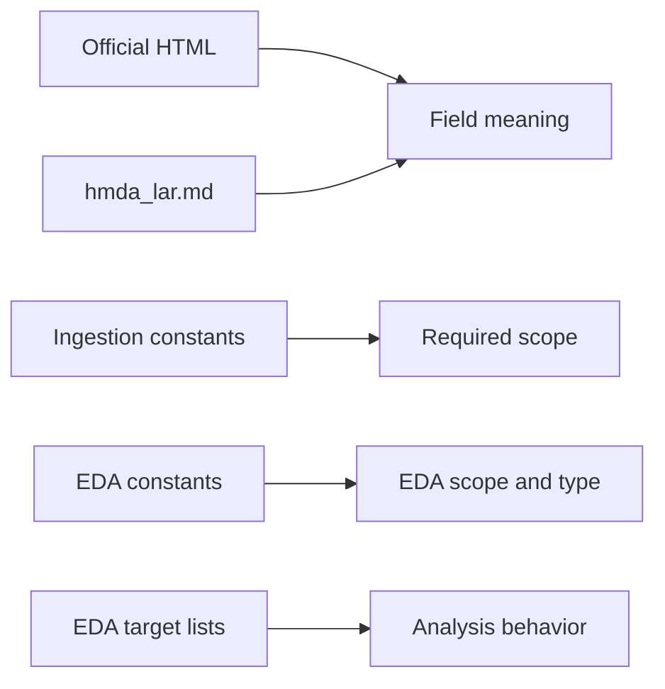
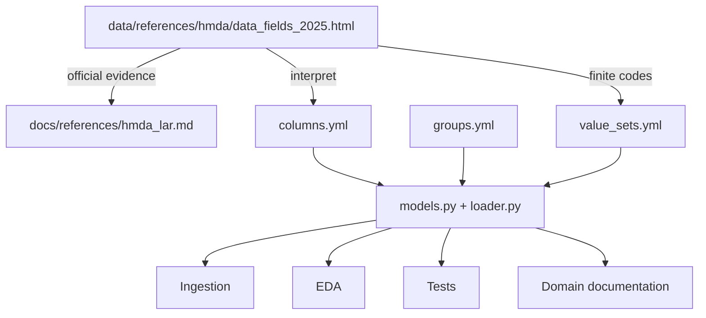
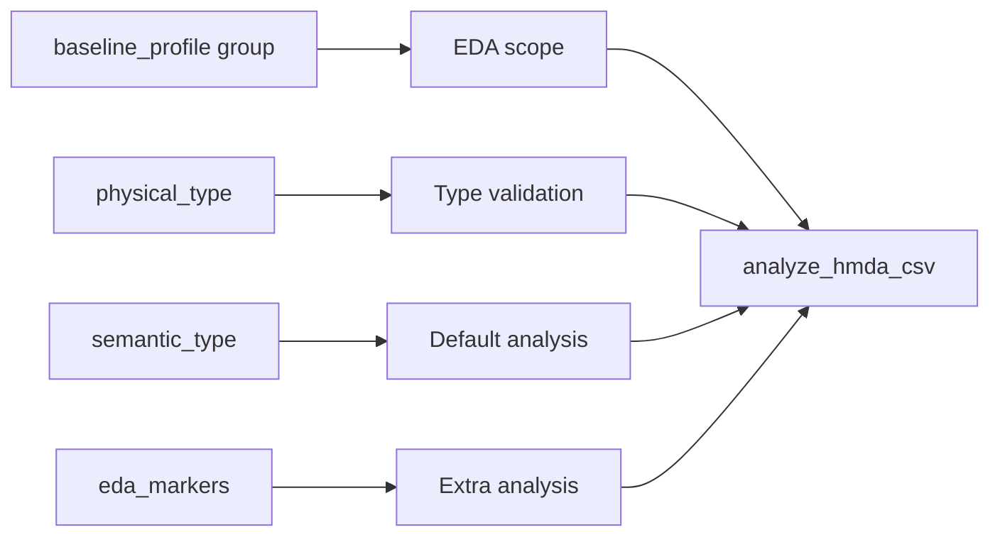
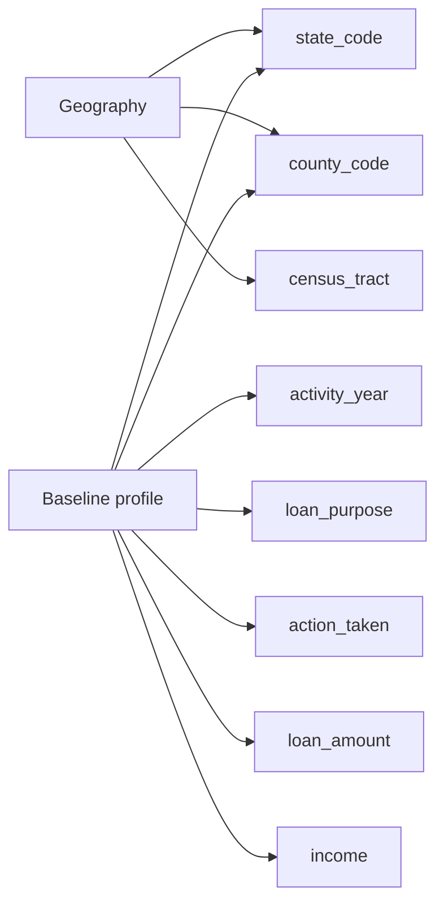
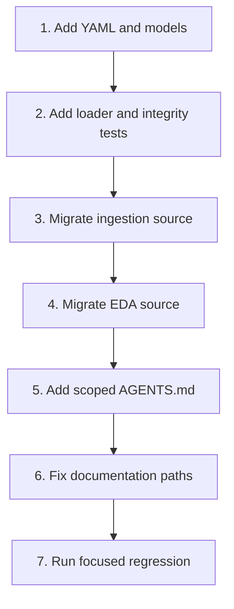

# Research: hmda-column-contract-management

> **결론:** HMDA 컬럼 계약은 이미 생성된
> `src/project_pivot/hmda_data/contracts/`가 소유한다. 개별 컬럼은
> `columns.yml`, 컬럼 간 관계는 `groups.yml`, 유한 code set은
> `value_sets.yml`에 한 번만 기록한다. Pydantic loader가 이를 검증하고 필요한
> 역색인을 파생하여 ingestion과 EDA가 같은 계약을 사용하게 한다.

## Question

현재 프로젝트 구조에서 HMDA 99개 컬럼의 타입·의미·태그·EDA 행동·관계·코드값을
어디에 저장해야 ingestion, EDA, test와 사람이 보는 문서가 drift 없이 사용할 수
있는가?

## Scope

| Included | Excluded |
| --- | --- |
| 현재 repository 구조와 domain boundary | HMDA 원천 다운로드 자동화 |
| 2025 Public HMDA LAR 99개 컬럼 | raw 값 정제·삭제·보정 |
| YAML contract, Pydantic model과 loader | dbt model과 mart grain 재설계 |
| ingestion·EDA의 중복 metadata migration | incident threshold와 remediation 판단 |
| contract test, scoped agent rule, 관련 문서 갱신 | lakehouse 물리 저장 구현 |
| 기존 public API compatibility | dashboard와 notebook UI |

## Repository Snapshot

조사 기준은 `main` commit
`5209fce5fa089857ad94bd0e0f783f99015229d8`이다.

```text
project-pivot/
├── data/
│   ├── README.md
│   ├── raw/hmda/
│   ├── references/hmda/
│   │   └── data_fields_2025.html
│   ├── samples/hmda/
│   └── lakehouse/
│       ├── bronze/
│       ├── staging/
│       └── marts/
├── src/project_pivot/hmda_data/
│   ├── contracts/
│   │   └── __init__.py
│   ├── eda/
│   ├── ingestion/
│   ├── synthetic/
│   ├── errors.py
│   └── __init__.py
├── tests/
│   ├── AGENTS.md
│   └── hmda_data/
│       ├── eda/
│       ├── test_ingestion.py
│       ├── test_ingestion_partition.py
│       └── test_synthetic.py
└── openspec/research/
    └── AGENTS.md
```

### Findings

| Finding | Evidence | Class |
| --- | --- | --- |
| `hmda_data`는 원천 검증, Bronze 적재와 합성 입력을 소유한다. | `docs/domains/hmda-data.md` | Authoritative |
| HMDA contract package가 이미 생성되어 있다. | `src/project_pivot/hmda_data/contracts/__init__.py` | Observed |
| 공식 field snapshot은 `data/references/hmda/data_fields_2025.html`에 있다. | repository file | Observed |
| `data/README.md`는 실제와 다른 `data/reference/` 단수형을 설명한다. | `data/README.md` | Observed |
| `hmda_lar.md`는 오래된 raw 경로를 source로 적고 있다. | `docs/references/hmda_lar.md` | Observed |
| ingestion은 필수 컬럼 7개를 직접 소유한다. | `ingestion/_common.py :: REQUIRED_HMDA_COLUMNS` | Observed |
| EDA도 같은 7개 컬럼과 컬럼별 DuckDB type family를 직접 소유한다. | `eda/analysis.py :: REQUIRED_EDA_COLUMNS, EXPECTED_TYPE_FAMILIES` | Observed |
| EDA의 category·numeric 대상도 tuple로 직접 선택한다. | `eda/analysis.py :: _collect_code_distributions, _collect_numeric_summaries` | Observed |
| `pydantic`, `pyyaml`은 production dependency다. | `pyproject.toml` | Authoritative |
| Python 3.13, strict mypy와 domain별 pytest 구조를 사용한다. | `pyproject.toml`, `tests/AGENTS.md` | Authoritative |
| `data/lakehouse/`는 있지만 현재 architecture는 local DuckDB를 사용하고 lakehouse를 scope에서 제외한다. | `docs/ARCHITECTURE.md` | Authoritative |
| `data/**/*`는 기본적으로 ignore된다. | `.gitignore` | Authoritative |

## Problem



같은 컬럼 지식이 여러 파일에서 직접 관리된다.

```text
activity_year · state_code · county_code · loan_purpose
                  · action_taken · loan_amount · income

├── ingestion/_common.py
├── eda/analysis.py
├── docs/references/hmda_lar.md
└── 향후 test와 시각화 코드
```

문제는 파일 수가 아니라 **동일한 사실의 소유자가 여러 명인 것**이다.

## Decision Summary

| Decision | Result |
| --- | --- |
| Owner | `project_pivot.hmda_data.contracts` |
| Individual column source | `columns.yml` |
| Cross-column relation source | `groups.yml` |
| Finite code-label source | `value_sets.yml` |
| Validation | immutable Pydantic models |
| Loading | `importlib.resources`와 process cache |
| Reverse lookup | loader가 파생 |
| Ingestion required set | `required` tag에서 파생 |
| Default EDA scope | `baseline_profile` group에서 파생 |
| EDA behavior | physical type + semantic type + group + marker |
| Official human reference | `docs/references/hmda_lar.md` |
| Full generated catalog | initial change에서 제외 |
| Scoped editing rule | `contracts/AGENTS.md` |

## Information Architecture



| Layer | Responsibility | Authority |
| --- | --- | --- |
| Evidence | 공식 field 설명과 code 근거 | `data/references/hmda/data_fields_2025.html` |
| Human reference | 사람이 읽는 번역·요약 | `docs/references/hmda_lar.md` |
| Executable contract | project type·분류·관계 | `hmda_data/contracts/*.yml` |
| Behavior | 적재, EDA와 validation | Python modules |

Python code는 HTML이나 Markdown을 runtime contract로 parsing하지 않는다.

## Target Structure

```text
src/project_pivot/hmda_data/contracts/
├── AGENTS.md
├── __init__.py
├── loader.py
├── models.py
├── columns.yml
├── groups.yml
└── value_sets.yml

tests/hmda_data/contracts/
├── test_loader.py
├── test_columns.py
├── test_groups.py
└── test_value_sets.py
```

새 `column_registry/` package를 만들지 않는다. 현재 repository가 이미
`hmda_data/contracts/`를 예약했다.

`data/lakehouse/`에도 두지 않는다. 이 directory는 물리 데이터 계층이며 현재
project scope도 아니다. 계약은 Python runtime과 package distribution이 사용하는
application asset이다.

## Contract Shape

```text
HMDAColumnContracts
├── columns: name → ColumnContract
├── groups: name → ColumnGroup
├── value_sets: name → ValueSet
└── derived indexes
    ├── physical type → columns
    ├── semantic type → columns
    ├── tag → columns
    ├── marker → columns
    ├── column → groups
    └── value set → columns
```

### `columns.yml`

한 컬럼만 보고 결정할 수 있는 **executable metadata**만 저장한다.
공식 설명의 긴 prose는 `hmda_lar.md`에 남긴다.

```yaml
version: 1
source_schema: public-hmda-lar-2025

columns:
  - name: activity_year
    ordinal: 1
    physical_type: integer
    semantic_type: year
    tags:
      - required
      - temporal
    eda_markers: []

  - name: action_taken
    ordinal: 13
    physical_type: integer
    semantic_type: nominal_category
    value_set: action_taken
    tags:
      - required
      - outcome
    eda_markers:
      - mixed_representation
```

| Field | Required | Meaning |
| --- | --- | --- |
| `name` | Yes | 원천 컬럼 이름 |
| `ordinal` | Yes | 1부터 시작하는 공식 순서 |
| `physical_type` | Yes | 저장·읽기 관점의 대표 타입 |
| `semantic_type` | Yes | 값의 주된 업무 의미 |
| `value_set` | No | 유한 code set 참조 |
| `tags` | Yes | 컬럼 하나가 가진 직교 속성 |
| `eda_markers` | Yes | 일반 규칙으로 추론할 수 없는 추가 EDA 행동 |

### `groups.yml`

여러 컬럼이 함께 있어야 의미가 생기는 관계를 저장한다.

```yaml
version: 1

groups:
  baseline_profile:
    kind: analysis_scope
    ordered: true
    columns:
      - activity_year
      - state_code
      - county_code
      - loan_purpose
      - action_taken
      - loan_amount
      - income

  geography:
    kind: domain
    ordered: true
    columns:
      - state_code
      - county_code
      - census_tract

  aus:
    kind: repeated_response
    ordered: true
    columns:
      - aus-1
      - aus-2
      - aus-3
      - aus-4
      - aus-5
```

한 컬럼이 여러 그룹에 속하는 것은 정상이다.

```text
county_code
├── baseline_profile
├── geography
└── geographic_consistency
```

membership은 `groups.yml`에만 저장한다. `columns.yml.groups`를 만들지 않는다.

### `value_sets.yml`

유한 code와 canonical label을 저장한다. `Varying values`인 컬럼은 value set을
만들지 않는다.

```yaml
version: 1

value_sets:
  action_taken:
    values:
      "1": Loan originated
      "2": Application approved but not accepted
      "3": Application denied
      "4": Application withdrawn by applicant
      "5": File closed for incompleteness
      "6": Purchased loan
      "7": Preapproval request denied
      "8": Preapproval request approved but not accepted
```

```text
같은 의미 + 같은 code set   → 하나의 value set 재사용
같은 의미 + 다른 code set   → 별도 value set
Varying values              → value_set 없음
```

반복 slot의 실제 허용 code가 다르면 하나로 합치지 않는다.

## Metadata Semantics

```text
physical_type  = 값이 어떻게 저장되고 읽히는가
semantic_type  = 값이 업무적으로 무엇을 의미하는가
tags           = 컬럼 하나가 가진 직교 속성
eda_markers    = 기본 규칙으로 추론할 수 없는 추가 분석 행동
groups         = 여러 컬럼 사이의 관계와 순서
value_set      = 유한 code와 canonical label
```

### Single Ownership Rules

| Information | Canonical location | Do not repeat as |
| --- | --- | --- |
| Numeric/string behavior | `physical_type` | `numeric`, `string` tag |
| Category/identifier meaning | `semantic_type` | `categorical`, `identifier` marker |
| Repeated response | `groups.yml` | `multi_response` marker |
| Baseline EDA membership | `baseline_profile` group | 같은 이름의 tag |
| Ingestion requirement | `required` tag | 별도 required YAML list |
| Column-to-group index | loader-derived | `columns.yml.groups` |
| Type-to-column index | loader-derived | 별도 YAML list |
| Official long description | `hmda_lar.md` | `columns.yml.description` |

### Initial Vocabulary

실제 99개 컬럼을 분류하는 데 필요한 값만 시작한다.

| Dimension | Initial values |
| --- | --- |
| `physical_type` | `integer`, `float`, `string` |
| `semantic_type` | `identifier`, `year`, `currency`, `measurement`, `percentage`, `geographic_code`, `nominal_category`, `ordinal_category`, `free_text` |
| group `kind` | `domain`, `analysis_scope`, `repeated_response`, `consistency`, `hierarchy` |
| `eda_markers` | `value_heaping`, `robust_tail`, `sign_segments`, `decimal_precision`, `mixed_representation` |

새 vocabulary는 기존 값으로 표현할 수 없고 실제 consumer가 있을 때만 추가한다.

## Required And Baseline

현재 같은 7개 컬럼을 사용하지만 의미는 다르다.

```text
required tag
└── source가 반드시 가져야 하는 컬럼

baseline_profile group
└── 기본 EDA가 우선 분석하는 컬럼과 순서
```

```python
contracts = load_hmda_column_contracts()

required_columns = contracts.column_names_with_tag("required")
baseline_columns = contracts.group("baseline_profile").columns
```

두 집합의 현재 값이 같은지는 test로 고정한다. 하나를 다른 하나의 alias로 만들지
않는다.

## Loader And API

YAML은 repository 상대 경로가 아니라 package resource로 읽는다.

```python
from importlib.resources import files

contract_root = files("project_pivot.hmda_data.contracts")
```

loader 책임:

- 세 YAML load
- Pydantic validation
- cross-file reference validation
- derived index 생성
- immutable contract 반환
- process 내 caching

권장 API:

```python
from project_pivot.hmda_data.contracts import load_hmda_column_contracts

contracts = load_hmda_column_contracts()
column = contracts.column("income")
group = contracts.group("baseline_profile")
required = contracts.column_names_with_tag("required")
currency = contracts.column_names_with_semantic_type("currency")
groups = contracts.group_names_for_column("county_code")
```

consumer가 YAML dict 구조를 직접 탐색하지 않는다.

```python
# Avoid
registry["columns"][17]["tags"]
```

`project_pivot.hmda_data.contracts`는 stable API를 export한다. 기존 caller가 사용하는
다음 import는 initial migration에서 유지한다.

```python
from project_pivot.hmda_data import REQUIRED_HMDA_COLUMNS
```

## Consumer Migration

### Ingestion

```text
Before
ingestion/_common.py
└── REQUIRED_HMDA_COLUMNS 직접 소유

After
columns.yml tags.required
    ↓ loader
REQUIRED_HMDA_COLUMNS compatibility view
    ↓
validate_required_columns()
```

### EDA



DuckDB type family는 technology-specific code다. YAML에 DuckDB type name을
컬럼마다 반복하지 않는다.

```python
DUCKDB_TYPE_FAMILIES = {
    "integer": frozenset({...}),
    "float": frozenset({...}),
    "string": frozenset({...}),
}
```

EDA는 컬럼의 `physical_type`을 읽고 위 mapping을 적용한다.

Initial change에서는 EDA engine 전체를 다시 설계하지 않는다. 다음 중복 source만
교체하고 기존 output shape를 유지한다.

- `REQUIRED_EDA_COLUMNS`
- `EXPECTED_TYPE_FAMILIES`의 per-column 반복
- distribution·numeric target selection

## Human Visibility

### Overview Matrix

| # | Column | Physical | Semantic | Value set | Tags |
| ---: | --- | --- | --- | --- | --- |
| 1 | `activity_year` | integer | year | — | required, temporal |
| 4 | `state_code` | string | geographic_code | — | required, geography |
| 13 | `action_taken` | integer | nominal_category | action_taken | required, outcome |
| 22 | `loan_amount` | float | currency | — | required, monetary |

### Column Detail

```text
┌──────────────────────────────────────────────┐
│ action_taken                                 │
├──────────────────────────────────────────────┤
│ physical     integer                        │
│ semantic     nominal_category               │
│ value set    action_taken                   │
│ tags         required · outcome             │
│ groups       baseline_profile · outcome     │
└──────────────────────────────────────────────┘
```

공식 설명은 `docs/references/hmda_lar.md`의 같은 컬럼에서 확인한다.

### Relationship View



Initial implementation에서는 별도 99-column generated catalog를 commit하지 않는다.
기존 문서만 갱신한다.

| Document | Change |
| --- | --- |
| `docs/domains/hmda-data.md` | contract owner, API와 consumer boundary 추가 |
| `docs/references/hmda_lar.md` | 실제 source path와 executable contract link 수정 |
| `data/README.md` | `data/references/` actual path로 수정 |

전체 catalog가 실제로 필요해지면 YAML에서 생성하며 authored source로 취급하지 않는다.

## Scoped Agent Rules

`src/project_pivot/hmda_data/contracts/AGENTS.md`에는 이 directory에만 필요한 editing
invariant를 둔다.

```markdown
# HMDA Column Contract Rules

- `columns.yml`은 개별 컬럼의 executable metadata만 소유한다.
- `groups.yml`은 컬럼 간 관계와 순서만 소유한다.
- `value_sets.yml`은 유한 code와 canonical label만 소유한다.
- 같은 정보를 둘 이상의 YAML에 직접 저장하지 않는다.
- reverse index와 type/tag별 목록은 loader에서 파생한다.
- official snapshot, raw data와 generated output을 직접 수정하지 않는다.
- 새 enum, tag, marker는 실제 consumer가 있을 때만 추가한다.
- YAML 변경 시 contract test와 영향을 받는 consumer test를 실행한다.
```

이 규칙은 general project rule이 아니라 contract editing invariant이므로 scoped
`AGENTS.md`가 적절하다.

## Validation

### Contract Integrity

| Check | Expected result |
| --- | --- |
| Column count | 정확히 99개 |
| Column names | 모두 unique |
| Ordinal | 1부터 99까지 unique하고 연속 |
| Required fields | 모든 column에 존재 |
| Vocabulary | 허용된 enum만 사용 |
| Value-set reference | 참조 대상 존재 |
| Group reference | 모든 column 존재 |
| Repeated group order | 공식 slot 순서 유지 |
| Multi-group membership | 허용 |
| Reverse index | group source와 일치 |

### Compatibility

| Check | Expected result |
| --- | --- |
| `required` tag | 현재 ingestion 필수 7개와 일치 |
| `baseline_profile` | 현재 EDA 7개와 순서 일치 |
| Physical type mapping | 기존 EDA type validation과 동등 |
| Public import | `REQUIRED_HMDA_COLUMNS` 유지 |
| EDA output | 기존 fixture expectation 유지 |
| Package resource | working directory와 무관하게 load |

### Commands

```bash
uv run pytest tests/hmda_data/contracts -n 0 -q
uv run pytest tests/hmda_data/test_ingestion.py -n 0 -q
uv run pytest tests/hmda_data/eda -n 0 -q
uv run ruff check src tests
uv run mypy
uv run rumdl check openspec/research/hmda-column-contract-management
```

실제로 실행하지 않은 command는 통과로 기록하지 않는다.

## Implementation Sequence



1. `contracts/models.py`에 immutable Pydantic model을 정의한다.
1. 2025 snapshot과 `hmda_lar.md`를 근거로 세 YAML을 작성한다.
1. `contracts/loader.py`와 derived index를 구현한다.
1. contract integrity test를 통과시킨다.
1. ingestion constant를 contract-derived compatibility view로 변경한다.
1. EDA scope와 physical type expectation을 contract에서 파생한다.
1. scoped `AGENTS.md`와 관련 문서를 갱신한다.
1. focused test와 static validation을 실행한다.

## File-Level Handoff

| Action | Path |
| --- | --- |
| Expand | `src/project_pivot/hmda_data/contracts/__init__.py` |
| Create | `src/project_pivot/hmda_data/contracts/models.py` |
| Create | `src/project_pivot/hmda_data/contracts/loader.py` |
| Create | `src/project_pivot/hmda_data/contracts/columns.yml` |
| Create | `src/project_pivot/hmda_data/contracts/groups.yml` |
| Create | `src/project_pivot/hmda_data/contracts/value_sets.yml` |
| Create | `src/project_pivot/hmda_data/contracts/AGENTS.md` |
| Create | `tests/hmda_data/contracts/test_loader.py` |
| Create | `tests/hmda_data/contracts/test_columns.py` |
| Create | `tests/hmda_data/contracts/test_groups.py` |
| Create | `tests/hmda_data/contracts/test_value_sets.py` |
| Modify | `src/project_pivot/hmda_data/ingestion/_common.py` |
| Modify | `src/project_pivot/hmda_data/eda/analysis.py` |
| Preserve compatibility | `src/project_pivot/hmda_data/__init__.py` |
| Modify | `docs/domains/hmda-data.md` |
| Modify | `docs/references/hmda_lar.md` |
| Modify | `data/README.md` |

## Risks

| Risk | Containment |
| --- | --- |
| 99개 수동 입력 중 오타 | count, ordinal, uniqueness와 reference test |
| official meaning과 project metadata 혼동 | evidence, human reference, executable contract 분리 |
| YAML이 거대한 설정 언어로 성장 | initial vocabulary 고정, consumer 없는 field 금지 |
| package resource 누락 | `importlib.resources` load test |
| ingestion·EDA regression | compatibility import와 focused tests |
| yearly schema를 미리 과설계 | 현재는 `public-hmda-lar-2025` 하나만 지원 |
| Markdown과 value set 불일치 | YAML을 executable authority로 명시 |
| 새 snapshot이 `.gitignore`에 누락 | snapshot 추가 시 targeted exception 별도 검토 |

## Conflicts

| Sources | Conflict | Resolution |
| --- | --- | --- |
| actual path vs `data/README.md` | actual은 `data/references/`, README는 단수형 | README를 actual path에 맞게 수정 |
| actual path vs `hmda_lar.md` | actual snapshot과 문서 source 경로가 다름 | source link 수정 |
| `data/lakehouse/` vs architecture | placeholder는 존재하지만 lakehouse는 scope 밖 | column contract와 분리 |
| ingestion vs EDA | 같은 7개 컬럼을 각각 직접 소유 | tag와 group으로 의미를 분리하고 파생 |

## Assumptions

| Assumption | Validation or containment |
| --- | --- |
| 2025 Public HMDA LAR 99개 컬럼이 initial 대상이다. | snapshot heading과 registry count 검증 |
| year별 schema overlay는 아직 필요하지 않다. | 실제 차이가 확인될 때 별도 Research |
| 기존 EDA output shape는 유지해야 한다. | 현재 EDA tests를 regression oracle로 사용 |
| finite code label은 English canonical label로 저장한다. | 한국어 설명은 `hmda_lar.md`가 담당 |

## Non-Decisions

- `raw.hmda_loans`를 `bronze.hmda_loans`로 rename할지 여부
- `data/lakehouse/`를 실제 저장 계층으로 사용할지 여부
- 2026 이후 schema versioning 구조
- unknown code를 validation error로 처리할지 여부
- generated catalog를 commit할지 여부

위 결정은 column contract 구현을 막지 않는다.

## Impact

| Area | Impact or risk |
| --- | --- |
| `hmda_data/contracts` | canonical contract와 loader 소유 |
| ingestion | required column source 변경, public compatibility 유지 |
| EDA | baseline scope와 type expectation source 변경 |
| tests | integrity와 consumer regression 추가 |
| documentation | stale path와 ownership 설명 수정 |
| packaging | YAML package resource load 보장 |
| data directories | source snapshot은 read-only, lakehouse/raw 수정 없음 |

## Handoff

| Field | Content |
| --- | --- |
| Problem | HMDA 컬럼 지식이 문서와 Python 상수에 분산되어 drift 가능성이 있다. |
| Scope | `hmda_data/contracts`의 3개 YAML, models, loader, scoped rules, integrity tests와 ingestion·EDA migration |
| Evidence | `data/references/hmda/data_fields_2025.html`, `docs/references/hmda_lar.md`, 현재 ingestion·EDA constants |
| Required behavior | 99개 validation, derived index, required/baseline 의미 분리, compatibility import 유지 |
| Validation candidates | contract suite, ingestion test, EDA suite, package-resource test, ruff, mypy |
| Risks | transcription, metadata overgrowth, resource omission, consumer regression |
| Next action | bounded OpenSpec change를 생성하고 contract files와 integrity tests부터 구현 |
