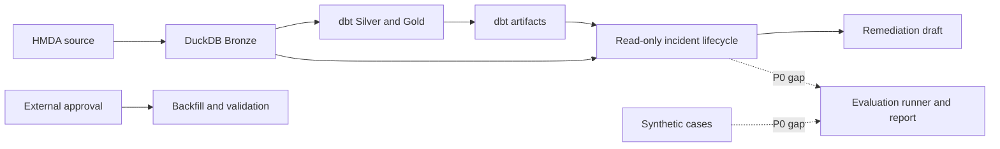

# MVP Baseline

> 질문: Project Pivot이 MVP로 제공해야 하는 workflow는 무엇이며, 현재 어디까지 왔는가?

## Summary

Project Pivot MVP는 **로컬 HMDA 데이터 품질 이상을 evidence와 함께 재현하고,
detection부터 recovery validation까지 검증하는 Data Reliability Incident workflow**다.

현재 data plane, read-only incident lifecycle, approval-gated backfill API,
evaluation report는 갖춰져 있다. 그러나 synthetic case를 실제 ingestion과 lifecycle에
연결해 결과를 생성하는 production evaluation runner가 없다. 따라서 MVP의 가장 가까운
미완료 항목은 `add-synthetic-lifecycle-evaluation`이다.

## Product Scope

| In scope | Out of scope |
| --- | --- |
| Local DuckDB, HMDA ingestion, dbt models, Dagster data plane | Lakehouse, distributed processing, cloud deployment |
| Evidence-backed incident, impact, remediation draft | Approval UI, full audit system, long-term monitoring |
| External approval 뒤 backfill validation | Approval 없는 자동 복구 |
| Synthetic workflow evaluation과 report | 범용 RCA와 lending policy 또는 credit-risk ML |

## MVP Completion Criteria

| Criterion | Current assessment | Evidence |
| --- | --- | --- |
| 반복 ingestion에도 raw row 중복이 없다 | Implemented | [vision](../../../docs/vision.md), data plane current state |
| dbt build가 성공하고 최신 artifact가 생성된다 | Implemented | [vision](../../../docs/vision.md), data plane current state |
| 각 incident가 evidence, affected asset, remediation action을 반환한다 | Implemented | [vision](../../../docs/vision.md), lifecycle current state |
| Synthetic case detection/action 성공률이 100%다 | **Not yet proven end-to-end** | [synthetic lifecycle research](../synthetic-lifecycle-evaluation/research.md) |
| 승인된 backfill 뒤 ingestion과 profile row count가 일치한다 | Implemented API; external approval integration은 제외 | [vision](../../../docs/vision.md), recovery current state |
| 미승인 backfill은 실행 전에 차단된다 | Implemented API | [vision](../../../docs/vision.md), recovery current state |

`Implemented`는 project vision의 current-state 선언과 해당 research의 확인 범위에
근거한다. 이 report는 fresh full-suite 실행이나 production deployment audit 결과는
아니다.

## P0: Close the Evaluation Gap

`add-synthetic-lifecycle-evaluation`은 normal과 다음 defect case를 case별 임시
DuckDB에서 실행한다.

| Case | Expected outcome |
| --- | --- |
| `normal` | incident 없음, false positive 없음 |
| `volume_drop` | volume-drop incident와 expected remediation action |
| `null_spike` | null-spike incident와 expected remediation action |
| `schema_drift` | schema-drift incident와 expected remediation action |
| `freshness_delay` | freshness-delay incident만 탐지 |

이 runner는 synthetic output을 ingestion-compatible staging filename으로 정규화하고,
lifecycle 결과를 기존 `EvaluationCaseResult`와 Markdown report로 변환한다. lifecycle의
read-only 경계, `pipeline_job`, source/project database는 변경하지 않는다.

### Acceptance Signals

1. 다섯 case의 expected incident와 action이 일치한다.
1. detection/action 성공률이 100%다.
1. 동일 입력으로 두 번 실행해 동일한 결과를 얻는다.
1. case 간 schema와 data가 격리된다.
1. source와 configured project database가 변경되지 않는다.
1. freshness case가 의도하지 않은 `schema_drift`를 만들지 않는다.

## Known Decision Before Implementation

freshness generator가 baseline에 없는 `observed_at` column을 추가하므로, 현재 그대로는
freshness case가 `schema_drift`도 함께 탐지한다. OpenSpec design은 다음 중 하나를
선택해야 한다.

| Option | Trade-off |
| --- | --- |
| baseline과 모든 case에 동일한 `observed_at` schema를 제공 | 구현이 단순하지만 fixture contract가 넓어진다 |
| freshness metadata를 table schema 밖에서 주입 | case 의미가 더 명확하지만 request/profile 경계 설계가 필요하다 |

## Roadmap After P0

| Priority | Change | Why after P0 |
| --- | --- | --- |
| P1 | Isolated dbt remediation validation | Synthetic null/schema case로 candidate validation을 반복 측정해야 한다 |
| P2 | Dagster approval and audit integration | External state, idempotency, retry, audit persistence 결정이 필요하다 |

## Source Basis

| Source | Role |
| --- | --- |
| [vision](../../../docs/vision.md) | MVP product intent와 completion criteria의 authoritative source |
| [architecture](../../../docs/ARCHITECTURE.md) | system boundary와 ownership source |
| [next project priorities](../next-project-priorities/research.md) | P0/P1/P2 우선순위 결정 근거 |
| [synthetic lifecycle research](../synthetic-lifecycle-evaluation/research.md) | P0 feasibility, conflicts, validation detail |
