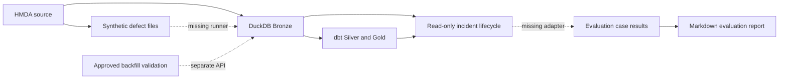
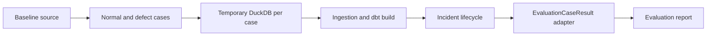

# Next Project Priorities

> 질문: 현재 Project Pivot에서 다음으로 무엇을 구현하는 것이 가장 가치 있는가?

## Conclusion

다음 change는 **synthetic incident end-to-end evaluation harness**가 적합하다.

현재 프로젝트에는 합성 결함 파일 생성, profile, incident detection, impact
analysis, remediation draft, evaluation report 집계가 각각 존재한다. 그러나 이
기능들을 실제 workflow로 연결해 `normal`, `volume_drop`, `null_spike`,
`schema_drift`, `freshness_delay`를 반복 실행하는 production API가 없다.

따라서 현재의 가장 큰 gap은 새로운 탐지 기능이 아니라 **이미 구현된 lifecycle이
실제 synthetic case에서 함께 동작한다는 실행 가능한 증거**다.

권장 순서는 다음과 같다.

1. P0: synthetic incident end-to-end evaluation harness
1. P1: remediation 격리 dbt validation
1. P2: 외부 approval과 audit history의 Dagster 연결

## Decision Basis

우선순위는 다음 기준으로 평가했다.

| Criterion | Meaning |
| --- | --- |
| Vision value | [프로젝트 비전](../../../docs/vision.md)의 MVP와 다음 단계에 직접 기여하는가 |
| Reuse | 이미 구현한 capability를 조합해 가치를 만들 수 있는가 |
| Uncertainty reduction | 후속 기능의 품질과 설계를 판단할 evidence를 만드는가 |
| Operational risk | 데이터 변경, 외부 상태, 복구 실패 위험이 낮은가 |
| Scope fit | 로컬 DuckDB, dbt, Dagster, reliability contract 경계를 유지하는가 |

## Current Capability Map

현재 경계는 [Architecture](../../../docs/ARCHITECTURE.md),
[Reliability](../../../docs/domains/reliability.md),
[Orchestration](../../../docs/domains/orchestration.md)에 명시되어 있다.

| Capability | Evidence | State |
| --- | --- | --- |
| Synthetic defect generation | [`hmda_data/synthetic/cases.py`](../../../src/project_pivot/hmda_data/synthetic/cases.py) | 4개 defect file 생성 가능 |
| Read-only incident lifecycle | [`data_operations/incident_lifecycle.py`](../../../src/project_pivot/data_operations/incident_lifecycle.py) | 실제 current profile에서 detection, impact, draft 조합 |
| Approved recovery | [`reliability/recovery/executor.py`](../../../src/project_pivot/reliability/recovery/executor.py) | approval gate 뒤 overwrite와 profile validation 수행 |
| Evaluation report | [`reliability/evaluation/reporter.py`](../../../src/project_pivot/reliability/evaluation/reporter.py) | 전달받은 case result를 집계하고 Markdown 출력 |
| Dagster data plane | [`orchestration/definitions.py`](../../../src/project_pivot/orchestration/definitions.py) | Bronze와 dbt asset만 등록 |

## Primary Gap

`EvaluationCaseResult`는 현재 test에서 직접 조립된다. repository 검색 기준으로
production code에는 synthetic case를 실행해 `EvaluationCaseResult`로 변환하는
호출 경로가 없다.

이 때문에 다음 MVP 신호를 한 번에 재현할 수 없다.

- 모든 synthetic incident가 기대한 type으로 탐지되는가
- incident별 remediation action이 기대와 일치하는가
- normal case가 false positive 없이 통과하는가
- report의 성공률이 실제 lifecycle 실행 결과를 반영하는가
- null spike, schema drift, freshness delay가 ingestion 이후에도 결함을 보존하는가

현재 [evaluation-report spec](../../specs/evaluation-report/spec.md)은 case result 집계와
파일 출력만 요구한다. 따라서 이 gap은 기존 spec의 단순 구현 누락이 아니라 새로운
capability change로 다루는 편이 명확하다.

## Candidate Comparison

점수는 1점이 낮음, 5점이 높음이다. Operational risk는 점수가 높을수록 위험이
낮다.

| Candidate | Vision value | Reuse | Uncertainty reduction | Operational risk | Total |
| --- | ---: | ---: | ---: | ---: | ---: |
| Synthetic end-to-end evaluation harness | 5 | 5 | 5 | 5 | 20 |
| Isolated dbt remediation validation | 5 | 4 | 4 | 4 | 17 |
| Dagster approval and audit integration | 4 | 3 | 3 | 2 | 12 |
| New detection rules | 2 | 3 | 2 | 5 | 12 |
| Cloud deployment or long-term monitoring | 1 | 1 | 2 | 1 | 5 |

### P0: Synthetic End-to-End Evaluation Harness

최소 범위는 synthetic file 생성부터 report 작성까지를 한 번에 실행하는 별도
evaluation API다. lifecycle의 read-only 경계와 Dagster `pipeline_job`은 변경하지
않는다.

가장 작은 acceptance signal은 다음과 같다.

- 동일한 작은 HMDA fixture로 5개 case를 실행한다.
- case별 database 또는 schema를 격리해 실행 순서의 영향을 제거한다.
- 기대 incident와 실제 incident가 일치한다.
- 기대 remediation action과 실제 action이 일치한다.
- report의 detection/action 성공률이 100%다.
- 실행을 두 번 반복해 결과가 동일하다.

### P1: Isolated dbt Remediation Validation

현재 remediation draft는 `add_not_null_test`, `add_schema_contract_test`,
`rerun_dbt_build` 같은 action을 제안하지만 실제 dbt project 변경이나 검증은 하지
않는다. 다음 단계에서는 draft를 적용하는 자동 수정기가 아니라, **후보 변경을 별도
target 또는 임시 project에서 compile/build해 검증하는 API**만 추가하는 것이
적절하다.

먼저 P0가 필요한 이유는 validation 결과를 synthetic null spike와 schema drift
case에서 반복 측정해야 하기 때문이다.

가장 작은 acceptance signal은 다음과 같다.

- 운영 DuckDB와 dbt target을 변경하지 않는다.
- 유효한 test 변경은 compile/build를 통과한다.
- 의도적으로 잘못된 test 또는 schema 변경은 실패 evidence를 반환한다.
- validation 결과는 remediation draft와 연결되지만 draft를 자동 승인하지 않는다.

### P2: Dagster Approval And Audit Integration

현재 approval contract와 approved backfill API는 있지만 외부 approval source와
감사 이력이 없다. Dagster 연결은 data plane의 `pipeline_job`에 recovery를 넣는
방식이 아니라 별도 job 또는 sensor가 승인된 request를 받아 명시적으로 실행하는
구조가 적합하다.

이 항목을 P2로 두는 이유는 외부 상태, idempotency, duplicate event, retry,
audit persistence를 함께 결정해야 해 앞선 두 후보보다 운영 위험이 크기 때문이다.

가장 작은 acceptance signal은 다음과 같다.

- pending 또는 rejected approval은 run을 생성하지 않는다.
- 동일 approval event를 두 번 받아도 backfill은 한 번만 실행된다.
- approval actor, time, action, run id, validation result가 조회 가능한 기록으로 남는다.
- recovery failure를 승인 성공으로 기록하지 않는다.
- 기존 `pipeline_job` asset selection은 유지된다.

## Not Recommended Next

| Candidate | Reason |
| --- | --- |
| 탐지 규칙 추가 | 기존 4개 규칙의 end-to-end evidence가 먼저다. 규칙 수를 늘리면 검증 공백만 커진다. |
| LangGraph 확장 | 현재 remediation graph는 결정론적 3-step 조합이다. 새로운 agent abstraction보다 실행 검증이 우선이다. |
| cloud deployment | [Architecture scope](../../../docs/ARCHITECTURE.md)와 비전에 명시된 비목표다. |
| full observability 또는 catalog | 현재 프로젝트의 로컬 reliability incident 검증 범위를 넘는다. |
| approval UI | 외부 approval contract와 audit semantics가 먼저 확정되어야 한다. |

## Proposed OpenSpec Changes

다음 change 하나만 먼저 만드는 것을 권장한다.

| Field | Proposal |
| --- | --- |
| Change name | `add-synthetic-lifecycle-evaluation` |
| Problem | 개별 capability는 있으나 synthetic case를 실제 lifecycle로 평가하는 runner가 없다. |
| Goal | normal과 4개 defect case를 격리 실행해 detection/action 결과와 report를 만든다. |
| Non-goals | Dagster 등록, approval 생성, backfill 실행, dbt file 자동 수정, cloud 실행 |
| New capability | `synthetic-lifecycle-evaluation` |
| Main dependency | 기존 ingestion, lifecycle, synthetic generator, evaluation reporter |

이 change가 100% 성공률과 반복 실행의 결정성을 증명한 뒤
`add-isolated-dbt-remediation-validation`을 제안한다. approval/audit integration은
그 다음 change로 분리한다.

## Risks And Open Questions

| Question | Why it matters | Recommended research spike |
| --- | --- | --- |
| baseline을 source EDA와 Bronze profile 중 무엇으로 둘 것인가 | 실제 운영 baseline contract와 평가 fixture가 달라질 수 있다 | 동일 fixture로 두 baseline의 schema, null, freshness 차이를 비교한다 |
| case별 dbt build가 필요한가 | 실행 시간이 크게 달라진다 | impact artifact를 고정한 run과 실제 build run의 결과 차이를 측정한다 |
| schema drift file을 기존 Bronze table에 적재할 수 있는가 | ingestion 단계에서 실패하면 lifecycle detection까지 도달하지 못한다 | 임시 database에서 schema drift case 한 건을 실행한다 |
| freshness 기준 시각을 어떻게 고정할 것인가 | 현재 시각 의존성은 반복 실행 결과를 흔든다 | 모든 case에 고정 `observed_at`을 전달한다 |
| action success의 정확한 의미는 무엇인가 | draft 제안 일치와 실제 remediation 성공은 다른 지표다 | P0에서는 draft action match로 제한하고 P1에서 validation success를 분리한다 |

## External Evidence Status

Dagster sensor와 asset check, dbt build와 state/defer 관련 공식 문서를 확인하려
했으나 현재 workspace의 network domain policy가 공식 documentation domain 접근을
차단했다. 따라서 이 문서의 우선순위는 repository의 code, tests, OpenSpec,
architecture boundary를 근거로 정했다.

P1 또는 P2 proposal을 만들기 전에는 해당 시점의 공식 Dagster와 dbt 문서를 다시
확인해야 한다. 특히 Dagster run status sensor의 idempotency semantics와 DuckDB
adapter에서 dbt state/defer 또는 별도 target을 사용할 때의 격리 수준은 최신 공식
근거가 필요하다.
