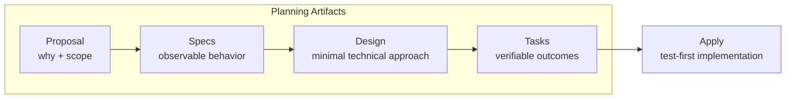

# Spec-Driven TDD

OpenSpec의 artifact dependency를 사용해 필요한 계획만 만들고 TDD-compatible implementation으로 연결하는 재사용 가능한 custom schema다.

| Path | Responsibility |
| --- | --- |
| [`schema.yaml`](schema.yaml) | 범용 workflow, artifact 의존성, 완료 조건과 Apply 계약 |
| [`templates/`](templates/) | artifact 구조·필드·parser contract와 구조에 종속된 작성 안내 |
| [`docs/`](docs/) | schema 설계 근거와 유지보수 기록 |

Schema는 특정 project, domain, 기술 stack이나 application/source layout을 가정하지 않는다.

활성 workflow와 작성 규칙은 위 owning file을 따르고, 설계 근거와 장기 보존 계약은 [`docs/`](docs/)에서 설명한다.
