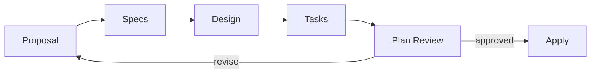

# Spec-Driven TDD

OpenSpec의 artifact dependency와 Plan Review gate를 사용해 TDD-compatible implementation을 준비하는 재사용 가능한 custom schema다.

| Path | Responsibility |
| --- | --- |
| [`schema.yaml`](schema.yaml) | 범용 workflow, artifact 의존성, 완료 조건과 Apply gate |
| [`templates/`](templates/) | 생성 artifact의 문서 구조, 필드와 parser contract |
| [`docs/`](docs/) | schema 개발·유지보수 문서 |
| [`../../config.yaml`](../../config.yaml) | Project Pivot 전용 context와 추가 규칙 |

Schema는 특정 project, domain, 기술 stack이나 파일 구조를 가정하지 않는다. Template이 소유하는 문서 형식과 parser 규칙도 반복하지 않는다.

자세한 설계와 유지보수 기준은 [`docs/`](docs/)를 따른다.
