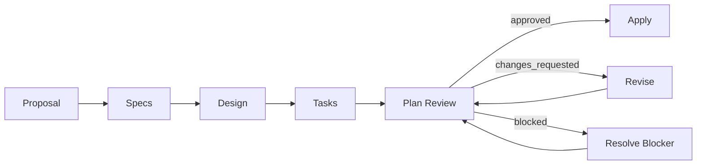

# Spec-Driven TDD

OpenSpec의 artifact dependency와 Plan Review gate를 사용해 TDD-compatible implementation을 준비하는 custom schema다.

## Workflow

## Files

| Path | Responsibility |
| --- | --- |
| `schema.yaml` | 재사용 가능한 artifact workflow와 최소 Apply 계약 |
| `templates/` | 생성 artifact의 구조와 parser contract |
| `docs/` | 스키마 개발·유지보수 문서 |
| `docs/baseline/` | 개선 과정에서 보존해야 하는 요구사항과 설계 결정 |
| `openspec/config.yaml` | 프로젝트별 context, rules와 operation guidance |

Plan Review는 고정 checklist와 `pending`, `in_progress`, `approved`, `changes_requested`, `blocked` 상태를 사용한다. `review_loop`는 완료한 전체 검토 횟수를 `0`부터 `8`까지 기록하며, 8회차에도 미통과 항목이 남으면 자동 검토를 중단한다.

Apply의 구체적인 명령과 프로젝트 정책은 schema가 아니라 프로젝트 `config.yaml`에 둔다.

자세한 설계는 [`docs/architecture.md`](docs/architecture.md), 변경 기준은 [`docs/baseline/DIRECTIVE.md`](docs/baseline/DIRECTIVE.md)를 따른다.
