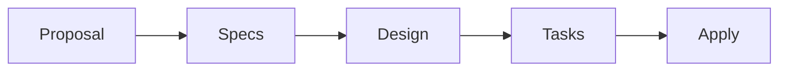

# Architecture

## Purpose

이 schema는 작업자 한 명의 세부 실행 순서가 아니라 OpenSpec Change의 계획 lifecycle과 artifact dependency를 정의한다. OpenSpec은 변경의 목적, 행동 계약, 기술적 경계와 구현 계획을 관리하고, Apply worker는 프로젝트 설정에 맞는 TDD-compatible feedback loop로 이를 구현한다.

## Workflow



## Artifact Responsibilities

| Artifact | Responsibility |
| --- | --- |
| Proposal | 변경 이유, 범위와 영향받는 Capability |
| Specs | 외부에서 관찰 가능한 행동 계약 |
| Design | 책임 경계, 기술적 결정과 검증 전략 |
| Tasks | 검증 가능한 구현 작업과 진행률 |

각 planning artifact는 자신의 책임을 직접 소유한다. Review 결과와 review process state는 이 schema의 artifact 책임이 아니다. 계획의 오류나 누락이 구현 중 확인되면 해당 책임을 소유하는 artifact를 수정하고 영향받는 downstream planning artifact를 다시 일치시킨다.

## Parsing Contract

모든 frontmatter와 Markdown heading은 문법적으로 유효해야 하지만, 모든 필드와 헤더를 안정적인 API로 취급하지 않는다.

| Surface | Stable Contract |
| --- | --- |
| Artifact identity | `type: openspec-spec-driven-tdd-<artifact-type>` |
| Tags | `tag` 또는 제한된 `prefix:tag` |
| Capability declarations | Proposal의 Capability 헤더와 Spec 경로 |
| OpenSpec delta specs | operation, Requirement, Scenario 헤더 |
| Task progress | 최상위 `- [ ]`, `- [x]` 체크박스 |
| Task counters | `tasks_total`, `tasks_completed` 파생 필드 |

### Tag Contract

허용 prefix는 `domain`, `subdomain`, `capability`다. 값은 lowercase kebab-case를 사용하며 동일 문자열 중복과 알 수 없는 prefix를 허용하지 않는다.

```regex
^(?:(?:domain|subdomain|capability):)?[a-z0-9]+(?:-[a-z0-9]+)*$
```

Tags는 검색과 분류 metadata다. workflow 상태, artifact dependency 또는 소유권 결정에 사용하지 않는다.

### Task Counters

`tasks.md` 체크박스가 source of truth이며 frontmatter 카운터는 파생 캐시다.

```text
tasks_total     = 파싱 대상 최상위 체크박스 수
tasks_completed = 완료된 [x] 체크박스 수
```

불일치 시 체크박스를 기준으로 카운터를 다시 계산한다.

## Configuration Boundary

| `schema.yaml` | `templates/` | Project config |
| --- | --- | --- |
| artifact DAG와 template 연결 | 문서 구조와 field | 기술 stack과 저장소 관례 |
| artifact 목적과 완료 조건 | parser contract | naming과 project-specific convention |
| 범용 test-first와 계획 환류 | task progress 표현 | 구체적인 validation과 tool 지침 |
| Apply dependency와 tracking | artifact별 작성 surface | 배포·병렬화 등 실행 정책 |

`schema.yaml`은 여러 프로젝트와 도구에서 재사용할 수 있는 workflow 의미만 가진다. 문서 surface의 세부 계약은 template이, 프로젝트별 지침은 project config가 소유한다.
