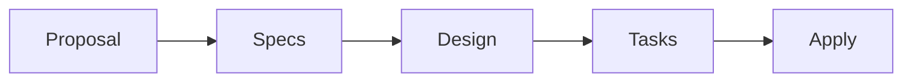

# Architecture

## Purpose

이 schema는 OpenSpec Change의 최소 planning lifecycle과 artifact dependency를 정의한다. Apply worker는 프로젝트 지침에 맞는 test-first feedback loop로 계획을 구현한다.

## Principles

- **KISS:** 각 artifact는 다음 단계에 필요한 최소 책임만 소유한다.
- **DRY:** 같은 규칙과 결론을 여러 artifact에 복제하지 않고 owning artifact를 source of truth로 둔다.
- **YAGNI:** 현재 Change에 필요하지 않은 section, decision, gate와 speculative task를 만들지 않는다.
- **Bounded feedback:** 오류는 원인을 소유하는 artifact와 직접 영향받는 downstream만 수정한다.

## Workflow



## Artifact Responsibilities

| Artifact | Responsibility |
| --- | --- |
| Proposal | 변경 이유, 범위와 영향받는 Capability |
| Specs | 외부에서 관찰 가능한 행동 계약 |
| Design | 구현에 필요한 기술적 결정, 책임 경계와 검증 전략 |
| Tasks | 독립적으로 검증 가능한 구현 결과와 진행률 |

각 planning artifact는 자신의 책임만 직접 소유한다. Proposal과 Specs를 Design에서 반복하거나 Design의 결정을 Tasks에 다시 설명하지 않는다.

## Execution Feedback

TDD는 implementation feedback loop이며 progress taxonomy가 아니다. 하나의 행동 변경 task 안에서 test-first로 RED → GREEN → 필요 시 REFACTOR를 수행한다.

Review와 self-review process state는 schema가 추적하지 않는다.

- 현재 범위의 미완료 작업이나 결함에 owning task가 있으면 그 task를 다시 열거나 수정한다.
- 현재 범위지만 owning task가 없으면 누락된 결과를 위한 가장 작은 implementation task만 추가한다.
- 계획 오류는 원인을 소유하는 artifact와 직접 영향받는 downstream artifact만 다시 일치시킨다.
- 독립적인 새 요구사항이나 별도 검증 가능한 범위는 현재 Change에 흡수하지 않는다.

Review finding 자체를 별도 remediation workstream으로 만들지 않는다.

## Parsing Contract

모든 frontmatter와 Markdown heading은 문법적으로 유효해야 하지만, 모든 필드와 heading을 안정적인 API로 취급하지 않는다.

| Surface | Stable Contract |
| --- | --- |
| Artifact identity | `type: openspec-spec-driven-tdd-<artifact-type>` |
| Tags | optional `tag` 또는 제한된 `prefix:tag` 값 |
| Capability declarations | Proposal의 Capability heading과 Spec 경로 |
| OpenSpec delta specs | operation, Requirement, Scenario heading |
| Task progress | 모든 최상위 `- [ ]`, `- [x]` 체크박스 |
| Task counters | `tasks_total`, `tasks_completed` 파생 필드 |

### Tag Contract

허용 prefix는 `domain`, `subdomain`, `capability`다. 값은 lowercase kebab-case를 사용하며 동일 문자열 중복과 알 수 없는 prefix를 허용하지 않는다.

```regex
^(?:(?:domain|subdomain|capability):)?[a-z0-9]+(?:-[a-z0-9]+)*$
```

Tags는 optional 검색·분류 metadata다. workflow 상태, artifact dependency 또는 소유권 결정에 사용하지 않는다. Proposal이 tags를 사용하면 Change-level 분류를 소유한다. 다른 artifact는 필요한 경우에만 tags를 명시하며, Spec의 capability identity는 tag가 아니라 `specs/<capability>/spec.md` 경로가 소유한다.

### Task Counters

Parser는 최상위 체크박스를 구조적으로 집계한다.

```text
tasks_total     = 파싱된 최상위 체크박스 수
tasks_completed = 그중 완료된 [x] 체크박스 수
```

따라서 authoring contract가 최상위 체크박스를 구현 결과에만 예약한다. Review, self-review, TDD phase, 선행 조건과 승인 대기 같은 process/gate state는 일반 text나 list로 표현한다.

## Configuration Boundary

| `schema.yaml` | `templates/` | Project config |
| --- | --- | --- |
| artifact DAG와 template 연결 | 문서 구조와 field | 기술 stack과 저장소 관례 |
| artifact 목적과 완료 조건 | parser contract | naming과 project-specific convention |
| 범용 test-first와 제한된 계획 환류 | task progress 표현 | 구체적인 validation과 tool 지침 |
| Apply dependency와 tracking | artifact별 작성 surface | 배포·병렬화 등 실행 정책 |

`schema.yaml`은 여러 프로젝트와 도구에서 재사용할 수 있는 workflow 의미만 가진다. 문서 surface의 세부 계약은 template이, 프로젝트별 지침은 project config가 소유한다.
