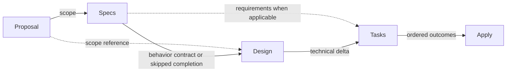

# Architecture

## Purpose

이 schema는 OpenSpec Change의 planning lifecycle과 artifact dependency를 정의하고, Apply를 프로젝트 지침에 맞는 TDD-compatible implementation으로 연결한다.

## Workflow

Spec-level behavior가 없는 Change는 OpenSpec change metadata의 `skip_specs: true`를 사용한다. OpenSpec이 Specs artifact를 완료로 취급하므로 dependency graph는 유지하고 delta Spec만 생성하지 않는다.

## Artifact Responsibilities

| Artifact | Responsibility |
| --- | --- |
| Proposal | 변경 이유, 범위와 영향받는 Capability 또는 spec-free 판단 |
| Specs | 외부에서 관찰 가능한 행동 계약 |
| Design | Proposal과 Specs만으로 결정되지 않는 non-obvious technical delta |
| Tasks | 독립적으로 검증 가능한 구현 결과와 진행률 |

이 분리는 같은 판단을 여러 artifact에 복제하지 않고 각 단계가 다음 단계에 필요한 정보만 제공하기 위한 것이다.

### Design Admission Test

Design은 Change의 독립적인 요약 문서가 아니다. Candidate 내용은 다음 순서로 owner를 판정한다.

| Question | Owner |
| --- | --- |
| 왜 바꾸는가, 어디까지 바꾸는가, 무엇에 영향이 있는가? | Proposal |
| 외부에서 관찰하거나 Requirement/Scenario로 검증할 수 있는가? | Specs |
| 구현 결과 또는 완료 조건인가? | Tasks |
| 위에 해당하지 않고, 빼면 구현 선택·변경되는 technical boundary·constraint·migration mechanism이 실질적으로 미정이 되는가? | Design |

기술 용어를 사용하거나 implementation에 관한 설명이라는 이유만으로 Design에 들어가지 않는다. Observable contract를 기술적인 표현으로 다시 쓴 내용도 Specs가 소유한다. Design에서 새로운 observable behavior가 발견되면 Specs로 되돌리고, migration의 실제 작업 순서와 완료 조건은 Tasks로 보낸다.

추가 technical delta가 없으면 Design은 기존 architecture를 따른다는 한 문장으로 끝낸다. 이 경우 artifact 존재 자체를 정당화하기 위해 Proposal이나 Specs를 반복하지 않는다.

## Design Rationale

### Outcome-Based Tasks

TDD의 RED/GREEN/REFACTOR는 implementation feedback loop다. 이를 별도 progress item으로 모델링하면 실제 구현 결과보다 task 수가 빠르게 늘어난다. 따라서 Tasks는 실행 phase가 아니라 검증 가능한 구현 결과를 중심으로 추적한다.

### Spec-Free Changes

Pure refactor, tooling 또는 docs 변경처럼 spec-level behavior가 바뀌지 않는 작업은 새로운 Capability나 Requirement를 만들지 않는다. OpenSpec의 `skip_specs: true` metadata를 사용해 zero-delta Change임을 명시하고, 이후 실제 behavior change가 생기면 marker를 제거한 뒤 Specs를 작성한다.

### Bounded Feedback

구현 중 발견한 문제를 별도 review-remediation workstream으로 누적하면 feedback 자체가 다시 planning과 review를 만드는 재귀가 생긴다. 현재 범위의 문제는 기존 계획의 owning surface로 되돌리고, 독립적인 새 범위는 현재 Change와 분리하는 방향을 사용한다.

## Contract Ownership

| Owner | Contract |
| --- | --- |
| [`../schema.yaml`](../schema.yaml) | artifact DAG, 목적·의존성·완료 조건과 Apply 의미 |
| [`../templates/`](../templates/) | artifact structure, field, parser surface와 구조에 종속된 작성 규칙 |
| [`baseline/DIRECTIVE.md`](baseline/DIRECTIVE.md) | 장기 보존할 requirement, decision, invariant와 변경 근거 |
| Project `openspec/config.yaml` | project-specific context, naming과 추가 규칙 |
| OpenSpec change metadata | `.openspec.yaml`의 `skip_specs` 같은 runtime metadata 의미와 validation semantics |

이 문서는 위 계약을 다시 정의하지 않고 구조와 설계 이유만 설명한다.
