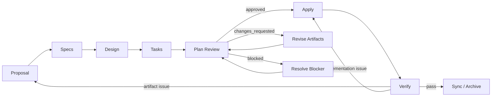

# Architecture

## Purpose

이 schema는 작업자 한 명의 세부 실행 순서가 아니라 OpenSpec Change의 계획 lifecycle과 artifact dependency를 정의한다. OpenSpec은 변경의 목적, 행동 계약, 기술적 경계와 구현 준비 상태를 관리하고, Apply worker는 프로젝트 설정에 맞는 TDD-compatible feedback loop로 이를 구현한다.

## Workflow



## Artifact Responsibilities

| Artifact | Responsibility |
| --- | --- |
| Proposal | 변경 이유, 범위와 영향받는 Capability |
| Specs | 외부에서 관찰 가능한 행동 계약 |
| Design | 책임 경계, 기술적 결정과 검증 전략 |
| Tasks | 검증 가능한 구현 작업과 진행률 |
| Plan Review | 계획의 일관성, 추적성과 실행 가능성 판정 |

## Plan Review Status

| Status | Meaning | Next Action |
| --- | --- | --- |
| `pending` | 검토가 시작되지 않았다. | 검토 시작 |
| `in_progress` | 검토 중이며 최종 판정 전이다. | 검토 계속 |
| `approved` | 계획이 구현 가능한 상태다. | Apply 진행 |
| `changes_requested` | 계획 artifact 수정이 필요하다. | 수정 후 재검토 |
| `blocked` | 외부 조건이나 근거 부족으로 진행할 수 없다. | Blocker 해결 후 재검토 |

`approved`와 `changes_requested`는 일반적인 review decision 용어를 사용한다. `completed`처럼 결과를 숨기는 상태나 별도 verdict 필드는 사용하지 않는다.

## Parsing Contract

모든 frontmatter와 Markdown heading은 문법적으로 유효해야 하지만, 모든 필드와 헤더를 안정적인 API로 취급하지 않는다.

| Surface | Stable Contract |
| --- | --- |
| Artifact identity | `type: openspec-spec-driven-tdd-<artifact-type>` |
| Tags | `tag` 또는 제한된 `prefix:tag` |
| Capability declarations | Proposal의 Capability 헤더와 Spec 경로 |
| OpenSpec delta specs | operation, Requirement, Scenario 헤더 |
| Task progress | 최상위 `- [ ]`, `- [x]` 체크박스 |
| Task counters | `tasks_total`, `tasks_completed` 파생 필드 |
| Plan Review gate | frontmatter `status`; `### Required Changes` 체크박스 |

### Tag Contract

허용 prefix는 `domain`, `subdomain`, `capability`다. 값은 lowercase kebab-case를 사용하며 동일 문자열 중복과 알 수 없는 prefix를 허용하지 않는다.

```regex
^(?:(?:domain|subdomain|capability):)?[a-z0-9]+(?:-[a-z0-9]+)*$
```

Tags는 검색과 분류 metadata다. workflow 상태, artifact dependency 또는 gate를 결정하지 않는다.

### Task Counters

`tasks.md` 체크박스가 source of truth이며 frontmatter 카운터는 파생 캐시다.

```text
tasks_total     = 파싱 대상 최상위 체크박스 수
tasks_completed = 완료된 [x] 체크박스 수
```

불일치 시 체크박스를 기준으로 카운터를 다시 계산한다.

## Configuration Boundary

| Schema owns | Project config owns |
| --- | --- |
| Artifact DAG와 template 연결 | 기술 스택과 저장소 관례 |
| Parser contract | 테스트·lint·type-check 명령 |
| Plan Review gate의 의미 | 구체적인 테스트 범위와 순서 |
| TDD-compatible test-first 원칙 | 프레임워크별 RED/GREEN 실행 방식 |
| 계획 오류의 artifact 환류 | 병렬화, 자동 수정, 배포 절차 |

`schema.yaml`의 Apply instruction은 여러 프로젝트와 도구에서 재사용할 수 있는 최소 계약만 가져야 한다. 프로젝트별 지침은 `openspec/config.yaml`의 `context`, `rules`, `operations.apply.guidance`에 둔다.
