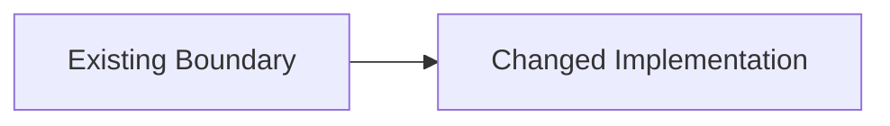

<!--
작성 규칙:
- Proposal과 Specs는 Design의 입력이지 다시 요약할 내용이 아니다.
- 각 candidate를 다음 순서로 분류한다.
  1. Why, scope, impact인가? → Proposal.
  2. 외부에서 관찰하거나 Requirement/Scenario로 검증할 수 있는 behavior, failure, acceptance, contract인가? → Specs.
  3. 구현 결과나 완료 조건인가? → Tasks.
  4. 제거하면 구현 선택, 변경되는 technical boundary, constraint 또는 migration mechanism이 실질적으로 미정이 되는가? → Design.
- 기술 용어를 사용하거나 implementation과 관련 있다는 이유만으로 Design에 넣지 않는다.
- upstream context가 꼭 필요하면 owning artifact나 Requirement를 짧게 참조하고 새로운 technical delta만 설명한다.
- Design에서 새로운 observable behavior가 필요하다고 판단되면 여기서 소유하지 말고 Specs로 되돌린다.
- 같은 내용을 Mermaid, 표와 본문으로 반복하지 않는다.
- 추가 technical delta가 없으면 `기존 architecture를 따른다.` 한 문장으로 끝내고 빈 섹션이나 placeholder를 남기지 않는다.
-->

## Technical Delta

<Tasks가 알아야 하지만 Proposal과 Specs만으로는 결정되지 않는 구현 선택, 변경되는 technical boundary, constraint 또는 migration mechanism만 기록한다.>

<!-- OPTIONAL: technical delta의 구조나 흐름이 텍스트보다 명확할 때만 사용한다. 전체 behavior flow를 다시 그리지 않는다.

-->

<!-- OPTIONAL SECTION: 새로 만들거나 변경하는 technical responsibility boundary가 있고 그 배치가 구현 선택일 때만 유지한다. Capability 또는 scope 경계를 반복하지 않는다. -->

## Boundaries

| Boundary | Owns | Does Not Own |
| --- | --- | --- |
| `<boundary>` | <새로 정하거나 변경하는 기술적 책임> | <인접 구현 책임> |

<!-- OPTIONAL SECTION: Specs를 만족하는 구현 선택지가 여러 개이고 그중 하나를 고정해야 Tasks가 명확해질 때만 유지한다. -->

## Decisions

### D1. <Decision>

- **Decision:** <선택한 접근법>
- **Rationale:** <이 선택이 필요한 기술적 이유>
- **Trade-off:** <중요한 비용이 있을 때만 기록>

<!-- OPTIONAL SECTION: migration의 strategy, ordering constraint 또는 compatibility mechanism을 결정해야 할 때만 유지한다. 실제 작업 순서와 완료 조건은 Tasks에 맡긴다. -->

## Migration

- <전환 전략 또는 compatibility mechanism>
