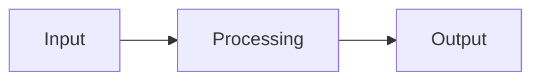

<!--
작성 규칙:
- Proposal의 동기·범위와 Specs의 행동 계약을 반복하지 않는다.
- 구현에 필요한 비자명한 판단만 기록하고 명백하거나 쉽게 되돌릴 수 있는 선택은 생략한다.
- OPTIONAL 블록은 내용이 있을 때만 유지한다.
- 같은 내용을 Mermaid, 표와 본문으로 반복하지 않는다.
- 빈 섹션이나 placeholder를 남기지 않는다.
-->

## Context

<구현 판단에 필요한 현재 구조, 제약과 dependency만 설명한다.>

## Architecture

<Specs를 만족시키는 접근법과 책임 분리를 구현에 필요한 수준으로 설명한다.>

<!-- OPTIONAL: 구조나 흐름이 텍스트보다 명확할 때만 사용한다.

-->

<!-- OPTIONAL SECTION: 기술적 책임 경계가 핵심 결정일 때만 유지한다. -->

## Boundaries

| Boundary | Owns | Does Not Own |
| --- | --- | --- |
| `<boundary>` | <담당 책임> | <다른 경계로 넘기는 책임> |

<!-- OPTIONAL SECTION: 구현 방향을 실제로 제약하는 비자명한 결정이 있을 때만 유지한다. -->

## Decisions

### D1. <Decision>

- **Decision:** <선택한 접근법>
- **Rationale:** <선택 이유>
- **Trade-off:** <중요한 비용이 있을 때만 기록>

## Testability

<중요한 행동과 경계를 어떤 관찰값으로 검증할지 설명한다. 구체적인 test case 목록은 Tasks나 test code에 맡긴다.>

<!-- OPTIONAL SECTION: 구현 전에 다뤄야 하는 실질적인 위험이 있을 때만 유지한다. -->

## Risks

- <위험과 완화 방법>

<!-- OPTIONAL SECTION: 데이터, schema, 배포 또는 호환성 전환이 실제로 필요할 때만 유지한다. -->

## Migration

- <전환 작업과 확인 방법>
