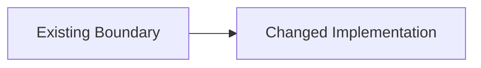

<!--
작성 규칙:
- Proposal과 Specs는 Design의 입력이지 다시 요약할 내용이 아니다.
- 구현을 실질적으로 제약하는 technical choice, responsibility boundary, constraint 또는 migration mechanism만 기록한다.
- Why, scope, impact, Capability, Requirement, Scenario, acceptance와 unchanged behavior/boundary를 반복하지 않는다.
- upstream context가 꼭 필요하면 owning artifact나 Requirement를 짧게 참조하고 새로운 technical delta만 설명한다.
- Design에서 새로운 observable behavior가 필요하다고 판단되면 여기서 소유하지 말고 Specs로 되돌린다.
- test scenario, acceptance, task completion과 일반적인 project risk는 Specs와 Tasks 등 owning artifact에 맡긴다.
- 문장이나 section을 제거해도 technical choice, boundary 또는 constraint가 사라지지 않으면 제거한다.
- 같은 내용을 Mermaid, 표와 본문으로 반복하지 않는다.
- 단순한 변경이면 한 문장으로 충분하며 빈 섹션이나 placeholder를 남기지 않는다.
-->

## Technical Delta

<Tasks가 알아야 하지만 Proposal과 Specs만으로는 결정되지 않는 구현상 선택 또는 제약만 간결하게 기록한다. 추가 technical delta가 없으면 그 사실만 한 문장으로 기록한다.>

<!-- OPTIONAL: technical delta의 구조나 흐름이 텍스트보다 명확할 때만 사용한다. 전체 behavior flow를 다시 그리지 않는다.

-->

<!-- OPTIONAL SECTION: 새로 만들거나 변경하는 technical responsibility boundary가 있을 때만 유지한다. Capability 또는 scope 경계를 반복하지 않는다. -->

## Boundaries

| Boundary | Owns | Does Not Own |
| --- | --- | --- |
| `<boundary>` | <새로 정하거나 변경하는 기술적 책임> | <인접 구현 책임> |

<!-- OPTIONAL SECTION: Specs만으로 여러 구현 선택지가 남고 그 선택이 구현을 실질적으로 제약할 때만 유지한다. -->

## Decisions

### D1. <Decision>

- **Decision:** <선택한 접근법>
- **Rationale:** <이 선택이 필요한 기술적 이유>
- **Trade-off:** <중요한 비용이 있을 때만 기록>

<!-- OPTIONAL SECTION: 데이터, schema, 배포 또는 호환성 전환의 구현 메커니즘을 결정해야 할 때만 유지한다. -->

## Migration

- <전환 메커니즘과 확인 방법>
