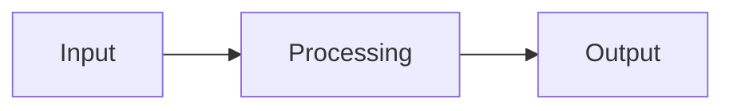
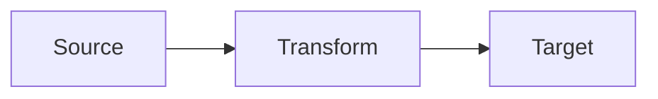

<!--
작성 규칙:
- 본문 헤더는 기본적으로 서술 구조이며 별도 계약에 명시되지 않으면 파싱 API로 간주하지 않는다.
- tags는 `tag` 또는 허용된 `prefix:tag` 형식만 사용한다.
- HOW, 책임 경계와 중요한 기술적 결정에 집중한다.
- tags를 유지한다면 Proposal tags와 정확히 일치시키며, 생략하면 상속으로 해석한다.
- Specs의 Requirement와 Scenario를 반복하지 않는다.
- OPTIONAL 블록은 내용이 있을 때만 유지한다.
- 같은 내용을 Mermaid, 표와 본문으로 반복하지 않는다.
- 빈 섹션, 표, 목록과 placeholder를 남기지 않는다.
-->

> [!NOTE]
> <핵심 접근법, 주요 경계와 기대 결과를 한 문단으로 요약한다.>

## Context

- **Current State:** <현재 구조와 핵심 문제>
- **Constraints:** <기술적 또는 운영상 제약>
- **Dependencies:** <관련 시스템 또는 선행 조건>

## Goals / Non-Goals

| Goals | Non-Goals |
| --- | --- |
| <이번 설계가 달성할 것> | <명시적으로 다루지 않을 것> |

## Architecture

<전체 접근법과 책임 분리를 간결하게 설명한다.>

<!-- OPTIONAL: 구조나 흐름이 텍스트보다 명확해질 때만 Mermaid를 사용한다. -->

<!-- OPTIONAL SECTION: 여러 Component의 책임과 변경을 구분해야 할 때만 유지한다. -->

### Components

| Component | Responsibility | Change |
| --- | --- | --- |
| `<component>` | <책임> | <추가 또는 변경 내용> |

### Boundaries

| Boundary | Owns | Does Not Own |
| --- | --- | --- |
| `<boundary>` | <담당 책임> | <다른 경계로 넘기는 책임> |

<!--
OPTIONAL SECTION: 여러 단계, 분기 또는 데이터 계약 때문에 흐름이 복잡할 때만 유지한다.
Mermaid 또는 표 중 더 명확한 하나를 우선하며, 서로 다른 정보를 줄 때만 함께 사용한다.
-->

## Data Flow

<!-- FORMAT A: 흐름과 분기가 중요할 때 사용한다. -->

<!-- FORMAT B: 단계별 데이터 계약이 중요할 때 FORMAT A 대신 사용한다.

| Step | From | To | Data / Contract |
| ---: | --- | --- | --- |
| 1 | `<source>` | `<target>` | <전달 또는 변환되는 데이터> |
-->

## Decisions

<!-- 다시 논의될 가능성이 있는 중요한 결정만 기록한다. -->

### D1. <Decision>

- **Decision** - <선택한 접근법>
- **Rationale** - <선택 이유>
- **Trade-off** - <얻는 것과 감수하는 것>
<!-- OPTIONAL: 의미 있는 대안을 검토했을 때만 유지한다. -->
- **Alternatives** - <검토했지만 선택하지 않은 접근법>

## Testability

<!-- 구체적인 테스트 케이스가 아니라 검증 경계와 전략을 작성한다. -->

| Boundary / Behavior | Test Strategy | Evidence |
| --- | --- | --- |
| <검증 대상> | <unit, integration, contract 또는 smoke> | <통과를 확인할 결과> |

- **TDD Boundary:** <RED에서 먼저 고정해야 할 행동>
- **Failure Signals:** <실패를 판별할 관찰값>

## Risks

| Risk | Impact | Mitigation |
| --- | --- | --- |
| <위험> | <영향> | <예방 또는 대응> |

<!-- OPTIONAL SECTION: 데이터, 스키마, 배포 또는 호환성 전환이 있을 때만 유지한다. -->

## Migration

| Phase | Change | Verification |
| ---: | --- | --- |
| 1 | <전환 작업> | <확인 방법> |

- **Compatibility:** <하위 호환성 또는 전환 기간>
- **Rollback:** <실패 시 복구 방법>

<!-- OPTIONAL SECTION: 구현 전에 해결해야 하거나 의도적으로 보류한 질문이 있을 때만 유지한다. -->

## Open Questions

| Question | Why It Matters | Next Step |
| --- | --- | --- |
| <질문> | <영향받는 결정 또는 범위> | <해결 방법> |
